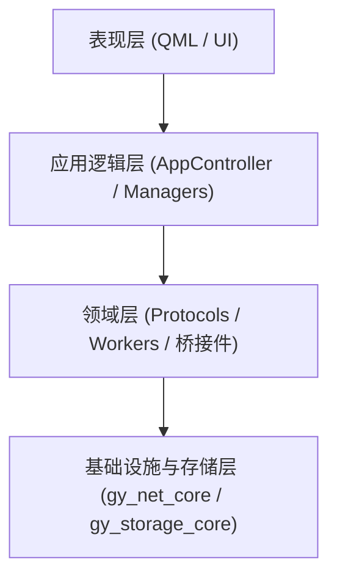
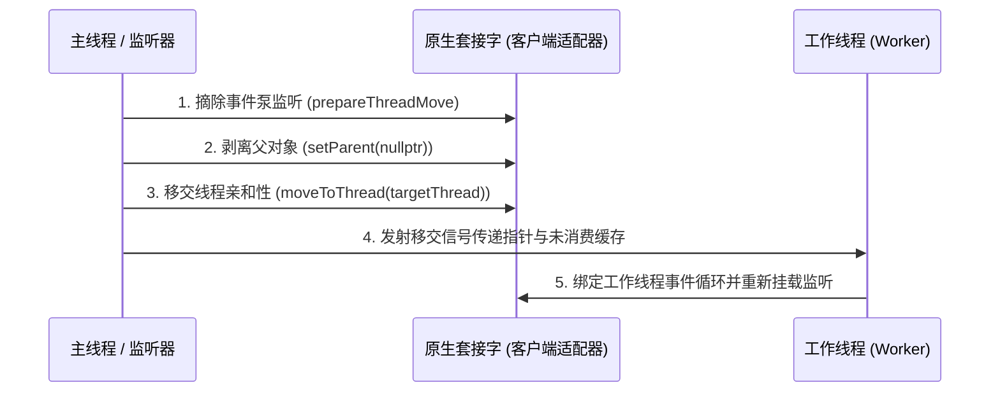

# 鸽邮（GridYard）—— C++23 与 Qt6 工程代码规范

> **文档状态**：现行标准（v7.26.0）  
> **适用范围**：GridYard 全仓 C++23、Qt6、QML、原生 POSIX 网络层及 CMake 构建脚本  
> **维护组织**：GridYard 研发团队  

---

## 核心规范速查表

| 规范维度 | 核心条款 | 约束等级 | 典型反例 | 正确示例 |
| :--- | :--- | :--- | :--- | :--- |
| **网络层选型** | 全局禁用 `Qt6::Network`，客户端用 `src/client/network/` 套接字适配器、服务端用 `gy_net_core` | **强制 (MUST)** | `#include <QTcpSocket>` | `#include "posix_tcp_socket.h"` |
| **外部通信协议** | 局域网 TLV 二进制传输与 JSON 协调行协议 | **强制 (MUST)** | 引入 HTTP REST 或 WebSocket | 原生 TCP/UDP + TLV 二进制编解码 |
| **头文件宏卫哨** | 统一使用 `#pragma once` | **强制 (MUST)** | `#ifndef SRC_FOO_H_` | `#pragma once` |
| **私有成员命名** | 单前置下划线 `_` 前缀 | **强制 (MUST)** | `m_socket` / `socket_` | `_socket` / `_finished` |
| **指针初始化** | 必须使用 `nullptr` | **强制 (MUST)** | `NULL` 或 `= 0` | `PosixTcpSocket *_socket = nullptr;` |
| **函数契约注释** | 生产代码函数上方统一使用 `//` 注释 | **强制 (MUST)** | 类内写 `@brief` / `@param` | `// 刷新本地网卡地址列表` |
| **成员变量注释** | 结构体与类成员变量必须行尾 `//` 说明 | **强制 (MUST)** | 无注释或换行繁复说明 | `int _port = 35100; // 本地监听端口` |
| **QML 交互模型** | 禁用 `MouseArea`，统一用 Handlers | **强制 (MUST)** | `MouseArea { onClicked: ... }` | `TapHandler { onTapped: ... }` |
| **C++↔QML 集成** | 依赖 `QML_ELEMENT` / `QML_SINGLETON` | **强制 (MUST)** | `engine.rootContext()->setContextProperty(...)` | 编译期 `qt_add_qml_module` 自动注册 |
| **文件命名约定** | C++ 为 `snake_case`，QML 为 `PascalCase` | **强制 (MUST)** | `PosixSocket.h` / `deviceCard.qml` | `posix_socket.h` / `DeviceCard.qml` |

---

## §1 体系架构与工程组织

### 1.1 四层领域驱动架构（DDD）

GridYard 整体设计严格遵循四层架构模型，确保关注点分离与依赖单向流动：

1. **表现层（Presentation Layer）**：
   - 路径：`src/client/Main.qml`、`src/client/ui/`、`src/client/utils/`
   - 职责：负责用户界面布局、视觉样式、动态交互与状态呈现。表现层通过声明式属性绑定响应底层状态变更，通过调用控制器暴露的槽函数或方法向上汇报用户操作意图。
   - 约束：严禁包含任何直接的文件读写、套接字操作或数据库执行逻辑。

2. **应用逻辑层（Application Layer）**：
   - 路径：`src/client/core/`
   - 职责：承接表现层意图，编排跨领域业务用例。包含应用生命周期总控（`AppController`）、传输会话调度（`TransferSessionManager`）、局域网聊天控制（`ChatManager`）、设备可达性与中继协调（`ReachabilityController`）以及本地历史查询（`HistoryController`）。
   - 约束：应用逻辑层不直接实现通信细节，而是组织领域对象与仓储接口完成用例。

3. **领域层（Domain Layer）**：
   - 路径：`src/core/`（纯 C++ 核心）、`src/client/domain/`、`src/client/network/`
   - 职责：定义系统的核心领域概念、协议实体、业务契约与仓储接口。协议编解码与领域类型的现役实现在 `src/core/` 的纯 C++ 双生版（`FrameCodecCore`、`ChatMessageCore`），客户端经 `codec_bridge.h` 桥接调用；设备发现服务（`DiscoveryService`）、传输服务后台（`P2pServer`）、分块发送/接收工作器（`FileSenderWorker`、`FileReceiverWorker`）与目录扁平化序列化器（`DirSerializer`）位于客户端网络与应用层。
   - 约束：领域层不依赖上层表现层，独立保持高内聚；`src/core/` 内严禁引入任何 Qt 类型。

4. **数据管理与基础设施层（Infrastructure / Data Layer）**：
   - 路径：`src/shared/net/core/`（`gy_net_core`）、`src/core/storage/`（`gy_storage_core`）、`src/client/storage/`
   - 职责：提供底层基础设施实现。事件泵与套接字核心（NetReactor、`TcpSocketCore` 等）为纯 C++；SQLite 访问基于 vendored sqlite3 C API 的 RAII 封装（`DatabaseCore` 与三个 `*RepositoryCore`），异步调度由 `DatabaseWorker` 承担；客户端侧的 `LocalDataBroker` 负责记录互转与任务编排。
   - 约束：核心层目标零 Qt 依赖并显式关闭 AUTOMOC/AUTOUIC/AUTORCC；Qt 类型只在客户端桥接边界出现。



### 1.2 组合根与生命周期模型

1. **入口精简化**：
   - `src/client/main.cpp` 作为程序启动入口，仅承担基础运行环境初始化：设置应用程序元信息、解析命令行参数（如多实例 `--instance=N` 与调试模式）、初始化统一日志器、向 Qt 元对象系统注册必要数据类型，并显式调用 `AppController::singleton()` 唤醒组合根。
   - 严禁在 `main.cpp` 中直接创建或挂载 QML 视图组件。

2. **组合根单例模型**：
   - `AppController` 采用 `QML_ELEMENT` 与 `QML_SINGLETON` 声明，作为唯一的客户端装配枢纽。
   - `AppController` 内部持有 `QQmlApplicationEngine`，其 `create()` 工厂函数必须严格返回内部维护的同一静态单例指针，确保在 QML 引擎单例解析与 C++ 调用时对象生命周期完全一致。
   - 客户端各子控制器（`ChatController`、`TransferController`、`ReachabilityController`、`HistoryController`）均由组合根集中实例化、注入依赖并统一管理生命周期。

### 1.3 模块化编译单元划分

全工程基于 CMake 组织为职责明确的静态库与可执行目标：

- `gy_core`：纯 C++23 领域类型、TLV 帧编解码、聊天消息编解码、目录哈希与 INI 配置读写，零 Qt。
- `gy_storage_core`：基于 vendored SQLite3 的纯 C++ 存储封装与三个仓储实现，零 Qt。
- `gy_net_core`：NetReactor 事件泵与 TCP/UDP 套接字核心，零 Qt。
- `gy_protocol_contracts`：协调与中继行协议键常量的 header-only 接口目标。
- `gy_shared`：TLV 协议常量头的 header-only 目标（编码实现已由 gy_core 承担）。
- `gy_rendezvous` / `gridyard_rendezvous`：纯 C++ 的协调节点与流式中继服务端库与独立程序，二进制零 Qt 依赖。
- `appGridYard`：桌面端主可执行程序，集成 QML 表现层、业务控制器、套接字适配器与数据层代管者，是产品中唯一链接 Qt 的目标。
- `tests`：基于 CTest 与 QTest 构建的自动化单元测试与并发回归测试套件，按需直编客户端源文件。

核心层与客户端层的完整分层说明、终态链接矩阵与红线验证方法见同目录《GridYard_纯C++核心架构说明.md》。

---

## §2 命名与代码排版规范

### 2.1 命名约定（Google + Qt6 混合规范）

- **文件命名**：
  - C++ 源文件与头文件一律使用小写蛇形命名（`snake_case`），如 `posix_tcp_socket.h`、`frame_codec.cpp`。
  - QML 组件文件与单例必须采用大驼峰命名（`PascalCase`），如 `Main.qml`、`DeviceCard.qml`、`SettingsDialog.qml`。
  - JavaScript 辅助文件采用大驼峰命名，如 `Style.js`、`FormatUtils.js`。
- **类型与类命名**：
  - 类、结构体、枚举名使用大驼峰命名（`PascalCase`），如 `TransferSessionManager`、`EndpointProbe`、`ErrorCode`。
  - 枚举项命名以小写 `k` 为前缀接大驼峰，如 `kTypeHello`、`kTypeTransferReq`、`kDefaultPort`。
- **函数与方法命名**：
  - 成员函数与普通方法使用小驼峰命名（`camelCase`），如 `startListening()`、`sendDirectedHello()`。
  - 槽函数采用动词或事件触发形式命名，如 `onTransferFinished()`、`handleFrameReady()`。
  - 信号（Signal）命名以过去分词或状态变更动词为主，如 `deviceAdded()`、`sessionFinished()`、`progressChanged()`。
- **变量命名**：
  - 类与结构体的私有/受保护成员变量统一添加单下划线前缀，如 `_socket`、`_port`、`_transferActive`。
  - 局部变量与形参使用小驼峰命名，如 `targetAddress`、`bytesWritten`。
  - 全局常量与静态只读变量使用 `k` 前缀，如 `kMaxFrameSize`、`kBufferSize`。

### 2.2 代码排版与格式化基线

项目根目录通过 `.clang-format` 与 `.editorconfig` 固化排版基线，提交前必须保证零格式差异：

1. **缩进与列宽**：
   - 源码缩进固定为 **4 个空格**，严禁使用制表符（Tab）。
   - 行宽上限基准为 **120 列**。
2. **大括号换行策略**：
   - 函数实现的大括号必须独立起行换行（Break Before Braces）。
   - 类声明、结构体、命名空间、控制流语句（`if`、`for`、`while`、`switch`）大括号采用同行贴合（Attach 风格）。
   - `if` 语句即便只有单行，也严禁省略大括号，确保控制流边界清晰。
3. **指针与引用对齐**：
   - 指针星号 `*` 与引用符号 `&` 统一靠向变量名右对齐：`Type *ptr = nullptr;`、`const QString &text;`。
4. **访问修饰符与命名空间**：
   - `public:`、`protected:`、`private:` 访问修饰符向左缩进 4 格顶格。
   - 命名空间块内容不产生额外缩进，底部注释规范为 `}  // namespace gy`。

---

## §3 原生 POSIX 网络编程契约

### 3.1 去 Qt6::Network 纯原生选型

- **底线约束**：全工程源码（包含客户端、服务端、测试用例）严禁引入 `Qt6::Network` 模块符号，不得出现任何 `<QTcpSocket>`、`<QUdpSocket>`、`<QTcpServer>`、`<QHostAddress>`、`<QNetworkAccessManager>` 头文件引用。
- **网络抽象层**：通信原语统一基于 `src/shared/net/`（`gy_net`）封装的 Linux 原生 POSIX 套接字实现，底层依托系统调用 `socket()`、`epoll()`/`poll()`、`fcntl()`、`bind()`、`connect()`、`accept()`、`send()`、`recv()`。

### 3.2 非阻塞套接字与事件调度

- **非阻塞模式保证**：所有创建的套接字均需在初始化时通过 `fcntl(fd, F_SETFL, flags | O_NONBLOCK)` 设置为非阻塞模式，防止网络波动或对端异常挂起导致线程卡死。
- **事件泵集成**：套接字核心由 NetReactor 事件泵（`gy_net_core`，独立线程 poll + eventfd）驱动；客户端适配器（`PosixTcpSocket` 等，位于 `src/client/network/`）把 Reactor 回调经 QueuedConnection 投回套接字归属线程，线程亲和与阻塞等待语义与 Qt 事件循环保持一致；服务端直接以回调风格挂接事件泵，不经任何 Qt 机制。
- **信号屏蔽**：套接字初始化时统一对套接字设置 `MSG_NOSIGNAL` 标记，或屏蔽 `SIGPIPE` 信号，避免连接对端异常断开时导致整个进程崩溃退出。

### 3.3 缓冲管理与写背压水线契约

- **环形与线性缓冲区结合**：采用带偏移量的缓冲设计，避免在接收大数据包时发生内存高频移动复制。
- **高低水位背压控制**：
  - 当写缓冲队列积压字节数超过设定的高水位阈值时，套接字暂停向上游触发拉流，防止内存无节制膨胀。
  - 当系统底层将积压数据消耗至低水位以下时，重新恢复写就绪通知与上游数据产生。
- **发送超时保障**：所有发送工作器必须支持基于 `std::atomic_bool` 的异步安全取消标志，在等待套接字写就绪时进行周期性标志探测，确保用户触发取消时能立刻释放资源退出。

### 3.4 跨线程移交（Safe Handover）所有权契约

在长连接接管或工作线程移交场景（如 P2P 接收、中继管道移交）中，必须遵循严格的跨线程安全移交契约：



1. **事件注销**：原拥有者在跨线程移交前，必须完全停用套接字在事件泵上的读写监听（`prepareThreadMove`），确保移交过程中无并发事件派发。
2. **所有权剥离**：清除父对象引用（`setParent(nullptr)`），防止对象树析构竞态。
3. **线程转移**：调用 `moveToThread(targetThread)` 迁移套接字对象的事件处理亲和性。
4. **缓冲转交**：若在握手阶段已有预读入但未消费的数据，必须打包作为参数随移交信号一并传递给工作对象，工作对象在挂载新事件前优先处理预读缓冲。

---

## §4 C++ 与 QML 集成规范

### 4.1 单向数据流原则

GridYard 严格维持表现层与业务逻辑层的单向数据流向：

- **意图上报（Upstream Intents）**：QML 表现层只负责采集用户交互动作，通过显式调用 C++ 控制器的 `Q_INVOKABLE` 方法或槽函数向上提交意图，不进行就地状态决策。
- **状态发布（Downstream State）**：C++ 控制器执行业务决策后，通过修改 `Q_PROPERTY` 绑定的变量并触发对应的 `NOTIFY` 信号，将最新状态单向广播至表现层。
- **表现层响应**：QML 组件通过属性绑定（Property Binding）响应状态变更，自动刷新界面呈现。

### 4.2 编译期注册机制

- **禁用动态挂载**：严禁使用 `QQmlContext::setContextProperty()` 向 QML 上下文动态注入 C++ 实例；严禁在运行时调用 `qmlRegisterType()` 或 `qmlRegisterSingletonType()`。
- **标准模块化机制**：所有暴露给表现层的 C++ 类型必须使用 Qt 现代宏标记：
  - 普通元素使用 `QML_ELEMENT`。
  - 全局控制器单例使用 `QML_SINGLETON`。
  - 数据载体使用 `Q_GADGET`。
- **CMake 集成**：在客户端 CMakeLists.txt 中统一采用 `qt_add_qml_module()` 进行声明式编译期模块绑定。

### 4.3 Q_PROPERTY 契约保障

每一个暴露给表现层的属性都必须遵守标准结构：

```cpp
Q_PROPERTY(bool isTransferring READ isTransferring NOTIFY isTransferringChanged)
```

1. **必须具备 NOTIFY**：除非明确为常量属性（`CONSTANT`），否则所有属性必须提供对应的 `NOTIFY` 信号，并在属性值实际变更时触发发射，杜绝无效刷新。
2. **防死循环绑定**：在属性 setter 实现中，必须包含值比对防护（`if (_val == newVal) return;`），阻断属性双向绑定引发的递归更新。
3. **主线程交互保证**：所有向 QML 发射的信号必须在主线程（GUI 线程）执行；后台工作线程的数据变更必须通过 Qt 跨线程信号槽机制分发到主线程控制器后再行发射。

### 4.4 QML 交互组件约束

- **禁用 MouseArea**：全工程 QML 文件严禁使用已被淘汰的 `MouseArea` 控件，统一采用现代输入处理原语：
  - 点击/点击选中：使用 `TapHandler`。
  - 拖拽/移动：使用 `DragHandler`。
  - 滚轮与悬停：使用 `WheelHandler` 与 `HoverHandler`。
- **样式常量集中化**：组件中涉及的颜色、边距、圆角、字体尺寸等视觉要素，必须统一引用 `src/client/utils/Style.js` 中的常量配置，严禁在 QML 内部硬编码十六进制色彩或魔数尺寸。

---

## §5 注释与契约规范

### 5.1 标准文件头模板

所有入仓的头文件与源码文件顶部，均需包含标准 Doxygen 文件头结构。文件头必须使用纯中文进行功能与架构职责阐明：

```cpp
/**
 * @file    filename.h
 * @version 7.26.0
 * @date    2026-10-23
 * @author  GridYard Team
 * @brief   一句话模块功能简述
 *
 * 详细阐述该类在四层架构中的定位、核心职责边界、关键协作对象
 * 以及生命周期管理模式等，篇幅为 2~3 行完整中文段落。
 */
```

- **严禁包含 Change Log 段落**：逐次提交的历史由 Git 提交记录原生承载，面向用户的版本摘要统一在根目录 `CHANGELOG.md` 中维护。源码文件头中严禁保留或新增任何修改历史或变更清单段。
- **版本号维护纪律**：本提交实际发生功能修改的文件，其 `@version` 与 `@date` 必须随主版本递增同步刷新；未被本提交改动的历史文件保持原有版本标注，严禁进行全仓批量无意义版本号刷版。

### 5.2 生产代码函数契约注释

- **统一使用单行双斜杠**：类体与函数声明上方统一采用 `//` 中文注释，直接说明函数功能、前置条件与预期行为。
- **严禁类内 Doxygen 标签**：在类体内部、函数上方或参数声明处，严禁出现 `@brief`、`@param`、`@return` 等繁琐标签，保持代码清爽精炼。
- **示例**：

```cpp
// 提交多步数据库操作事务，在发生任意步骤失败时自动回滚
bool gy::storage::DatabaseCore::runSteps(const std::vector<TransactionTask> &steps) const;
```

### 5.3 成员变量行尾注释规范

类和结构体的私有成员、受保护成员变量，必须在声明行末尾使用 `//` 补充说明其设计用途与生命周期约束：

```cpp
PosixTcpSocket *_socket = nullptr;  // 底层非阻塞 TCP 套接字指针，生命周期由当前工作器管理
int _retryCount = 0;                // 当前重连重试计数，达到阈值后转入失败状态
```

### 5.4 测试代码注释规范

测试套件重点在于断言意图的清晰表达。测试用例函数不强制要求顶部单行注释，但必须遵循结构化三段式（Arrange-Act-Assert）编写；仅在涉及复杂的异步等待条件、超时重试容差或模拟网络故障边界时，添加必要的行内说明。

---

## §6 现代构建、预设与测试体系

### 6.1 编译器基线与构建标准

- **工具链要求**：以 **C++23** 为编译语言标准，推荐采用 GCC 14+ 或 Clang 18+；CMake 最低版本要求为 3.25（推荐 4.2+）。
- **零警告编译**：工程默认开启严格编译告警，并将其视作构建质量红线：
  ```cmake
  target_compile_options(${TARGET} PRIVATE -Wall -Wextra -Wpedantic)
  ```
  所有生产代码与测试代码必须达到零编译错误、零编译警告标准。

### 6.2 CMakePresets 构建预设

根目录 `CMakePresets.json` 提供了标准化的配置与构建入口，规范团队统一开发环境：

- **`debug`**：包含完整调试符号表，关闭激进优化，便于 GDB 断点与事件追踪。
- **`release`**：开启全量 O3 优化与链接期优化，用于生产交付与真实吞吐压测。
- **`asan`**：集成 AddressSanitizer 与 UndefinedBehaviorSanitizer 内存和未定义行为消毒器，用于排查内存泄漏与越界访问。

### 6.3 自动化测试与高并发稳定性验证

- **单元测试隔离性**：每个测试目标（基于 QTest）必须保持环境自洁，网络测试必须使用动态随机端口或预置端口隔离，避免端口冲突；数据库测试必须在临时内存库或专属临时路径下运行。
- **回归与并发检验**：每次重大提交必须通过全量 28 组自动化单测。在网络层与中继链路改动后，需执行连续重复回归以杜绝偶发性竞态：
  ```bash
  ctest --test-dir build-ninja -R "test_posix_socket|test_relay_chain|test_file_transfer" --repeat until-fail:3 --output-on-failure
  ```

---

## §7 版本控制与 Git 规范

### 7.1 语义化版本体系（SemVer）

GridYard 严格遵循语义化版本规范（`MAJOR.MINOR.PATCH`）：

- **MAJOR（主版本号）**：当进行重大架构演进或协议重大破坏性升级时递增。
- **MINOR（次版本号）**：当新增完整业务特性、拓展协议兼容功能或完成大型模块重构时递增。
- **PATCH（修订版本号）**：当进行缺陷修复、健壮性补强、注释完善或代码排版规范化时递增。

**版本三处一致性铁律**：版本号递增时，以下三处必须严格保持字符级一致：
1. `src/CMakeLists.txt`：`project(GridYard VERSION X.Y.Z LANGUAGES CXX)`
2. `src/client/main.cpp`：`app.setApplicationVersion("X.Y.Z");` 及其文件头 `@version X.Y.Z`
3. 根目录 `README.md`：`| 项目版本 | vX.Y.Z |`

同时在 `CHANGELOG.md` 顶部追加对应版本的变更概要条目。提交前通过 `python3 src/scripts/check_versions.py` 执行零漂移检验。

### 7.2 团队原生中文 Git 提交规范

1. **显式文件暂存**：严禁执行全量添加 `git add -A` 或 `git add .`。每次暂存必须显式指定文件路径，防止本地未跟踪草稿或临时调试文件误入版本库。
2. **提交信息结构**：
   - **首行标题**：简明概括改动内容，末尾附带任务标识与版本号，例如：`配置工程代码排版规范预设与静态安全守卫脚本（工程规范化PhaseA，v7.26.0）`。
   - **空行隔开**。
   - **正文内容**：采用严谨、专业的自然中文段落，阐明修改背景、技术方案设计、解决的具体缺陷与边界保障。语句之间使用逗号与连接词自然衔接。
   - **排版禁忌**：正文中严禁使用 `-`、`*`、`1. 2. 3.` 等列表符号强行分行排版；严禁添加任何外部自动生成的作者署名（Co-Authored 等）。
