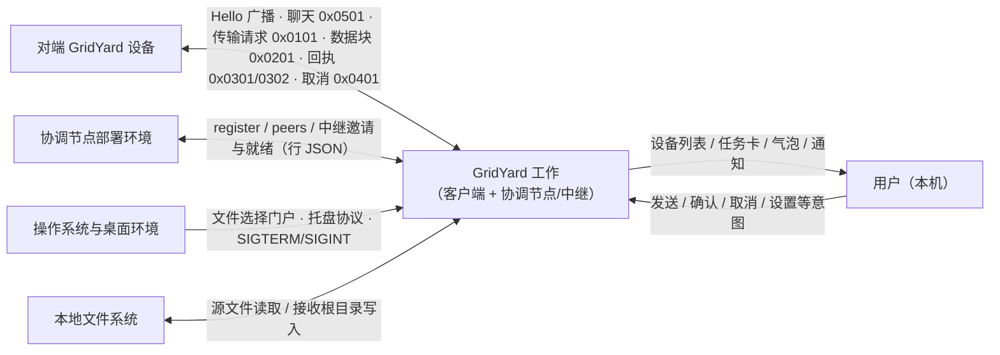

# 鸽邮（GridYard）需求文档

| 项目 | 内容 |
| :--- | :--- |
| 项目名称 | 鸽邮（GridYard）——局域网 P2P 文件传输与即时通讯桌面应用 |
| 文档版本 | V1.0 |
| 文档定位 | 需求文档（软件工程综合实训课程交付）：第一部分 业务与需求分析，第二部分 需求规格 |
| 编写单位 | GridYard 开发小组 |
| 文档状态 | 正式版 |

---

## 团队成员与分工

| 成员 | 学号与 Git 标识 | 主要方向 | 主要负责内容 |
|------|----------------|----------|--------------|
| 高扬 | 2024051604085GaoYang | 核心成员、全阶段参与、架构收口 | 项目结构设计、TLV 协议与编解码、核心控制器拆分、CMake 构建、打包部署、版本同步、接口文档、阶段验收，以及各阶段联调和问题收口 |
| 冯春霖 | 2024051604119FengChunlin | 网络、传输、多线程、持久化联调 | UDP 设备发现、P2P 连接、文件发送/接收工作器、聊天连接管理、传输异常处理、历史数据接入和联调修复 |
| 杜若贤 | 2024051604062DuRuoxian | QML 界面、交互体验、可视化呈现 | 设备列表、传输面板、会话页、聊天气泡、设置弹窗、传输历史视图、界面状态和视觉细节调整 |

> 分工细节与阶段投入情况见仓库 `doc/课程交付/团队分工说明.md`。实际开发中三人并非按目录完全切分：高扬贯穿全阶段负责架构、协议、构建与收口，冯春霖与杜若贤各自主责网络传输与界面交互，功能落地时交叉配合补测试、修问题与调整接口。

---

本文档分两部分：**第一部分**按课程所授需求工程方法组织分析制品——真实业务问题、Goal 陈述（目的—益处—衡量指标）、价值分析、范围与上下文、涉众、客户细分与画像、业务事件与业务用况、需求分类映射；**第二部分**为可直接验收的需求规格。两部分回答同一个系统：第一部分回答“为什么做、给谁做、边界在哪”，第二部分回答“做到什么程度、如何验证”。

---

# 第一部分　业务与需求分析

---

## 1 真实业务问题

### 1.1 现状系统（as-is）及其痛点

现状系统（system-as-is）下，校园局域网内的文件与消息传递依赖四类方式，各有硬伤：

| as-is 方式 | 典型问题 |
| :--- | :--- |
| U 盘 / 移动硬盘 | 需要物理接触与借还；忘带、跨楼层跑腿；插入不可信设备有安全风险 |
| 微信 / QQ 传文件 | 需双方登录账号；经公网服务器中转，隐私不可控；大文件与批量文件夹体验差 |
| 网盘链接 | 上传下载双向绕行公网，速度受出口带宽与限速策略约束；同样绑定账号 |
| SMB 共享 / scp | 需要双方 IP、账号与权限配置，普通用户门槛高；跨网段不可用 |

共同根因有二：**设备之间彼此不认识**——缺少自动发现机制，必须先交换 IP 或账号；**可达性不可预期**——校园网 AP 隔离使 UDP 广播与 TCP 直连是否可用随环境变化。

### 1.2 追问为什么：从痛点到机会

- 为什么传文件要绕 U 盘或微信？——因为局域网里没有开箱即用的直传工具。
- 为什么没有？——因为设备互相不知道对方的存在，任何直传都先要解决"发现"。
- 为什么"发现了"还常常传不成？——AP 隔离让广播不可达，TCP 直连也可能被隔离。
- 为什么不能要求用户调整网络？——用户无权修改校园网策略，可达性兜底必须由产品自身承担。

由此得出产品的三个必要条件：**零账号零公网的自动发现**（广播 / 邀请码 / 手动端点三条路径）、**发现失败时的登记互见**（独立协调节点）、**直连失败时的中继兜底**（流式中继，不落盘）。待建系统（system-to-be）的一切功能需求都服务于这三个必要条件。

### 1.3 问题世界与机器的边界

按"问题世界 vs 机器解决方案"的视角划分事象归属：

- **机器可控**：本机文件的读取与落盘、TCP/UDP 连接的建立与关闭、心跳与超时节律、确认弹窗与取消、同名改写与校验。
- **环境现象（只能观察、不能控制）**：对端是否在线、校园网是否隔离、磁盘剩余空间、对端用户是否点"接受"。

推论：凡依赖环境现象的目标，必须写明降级路径与明确终态——这正是第 13.2 节可达性四级降级与"任何一级不悬挂"（NFR-R1）的由来。

## 2 Goal 陈述（目的—益处—衡量指标）

### 2.1 目的（Purpose）

让同一局域网（包括 AP 隔离的校园网）内的用户，**无需账号、无需公网、无需配置**，即可互相发现、直传文件/文件夹并即时沟通；内容全程不经任何第三方服务器落盘。

### 2.2 益处与衡量指标（Advantage—Measurement）

| # | 益处 | 衡量指标 | 验证途径 |
| :--- | :--- | :--- | :--- |
| G1 | 大文件与整目录直传，不再依赖 U 盘与网盘 | 500MB 单文件回环（含哈希计算与校验落盘）吞吐 ≥ 190MB/s；支持任意大小与层级的文件夹 | NFR-P1 实测 195.01MB/s；第 15 章用例二、三 |
| G2 | 隐私可控，内容不出局域网 | 全部流量限定局域网地址；文件内容不经任何服务器落盘 | NFR-S4；11.4 节服务二进制零 Qt 与不落盘设计约束 |
| G3 | 零账号零配置上手 | 无账号体系；启动后 1 秒内完成首轮互发现 | NFR-P5 实测发现收敛 200ms；画像 P1 的上手路径 |
| G4 | 复杂校园网（AP 隔离）仍可用 | 隔离场景经"协调登记互见 → 直连 → 中继"完成传输；四级降级任何一级不悬挂 | 第 15 章用例八；NFR-R1 |
| G5 | 往来可追溯、可迁移 | 聊天/传输历史完整落库并跨重启恢复；换机经备份包整体迁移 | NFR-R3 幂等与事务；第 15 章用例六、七 |
| G6 | 误操作与恶意输入有底线 | 接收不覆盖已有文件（同名去重）；路径防穿越；校验失败即拒收 | FR-B5-09、FR-B5-03、FR-B5-10 |

### 2.3 可实现性检查

上述目标均存在已验证的技术路径：G1、G3 的实测数据出自 Release 构建的 A/B 基准与浸泡压测（第 13.1 节），G4 的降级链路有独立协调节点与中继服务两项交付物支撑（第 14.4 节），其余目标均被第 13 章自动化测试判据（NFR-C1）与第 15 章用例覆盖。不存在需要突破的未知技术。

## 3 价值分析

### 3.1 功能价值与心理价值

- **功能价值**（产品客观做成的事）：更快——直连吞吐实测 195MB/s，优于公网中转与网盘限速；更大——任意层级文件夹（含空目录结构）与多目标群发；更省——零介质成本、零账号与会员费用；可追溯——历史筛选、保留清理与备份迁移。
- **心理价值**（用户主观感受到的）：安心——隐私内容不出局域网、不经服务器落盘；掌控——接收前确认、传输中可取消、同名文件绝不覆盖；自信——不要求任何账号与配置，启动即用；被尊重——离线或隔离时给出明确原因与终态，不悬挂、不假装成功。

### 3.2 价值的获得者

| 获得者 | 获得的价值 |
| :--- | :--- |
| 使用者（局域网普通用户） | 3.1 节全部功能与心理价值 |
| 购买者（无采购决策；协调节点部署者承担一台低配主机） | 512MB 内存即可部署，无需公网地址与域名，成本近乎为零 |
| 发起组织（本课程教学班） | 获得一个可构建、可验收、过程可追溯（Git 全程托管）的作品，需求工程方法得到真实演练 |
| 开发组织（三人团队） | 完整走通"需求 → 设计 → 实现 → 测试 → 交付"链路，沉淀可复核的工程文档体系 |

## 4 范围与上下文

### 4.1 Context 图与相邻系统

工作（the work）= GridYard 客户端与协调节点/中继服务两个程序组成的系统整体。周围生态环境由以下相邻系统构成：

相邻系统与工作的输入/输出数据流明细：

| 相邻系统 | 工作接收（输入数据流） | 工作发出（输出数据流） |
| :--- | :--- | :--- |
| 用户（本机） | 发送/群发意图、接受/拒绝、取消、设置变更、托盘与关窗决策 | 设备列表、任务卡与进度、气泡与时间线、确认弹窗、完成通知卡、系统通知 |
| 对端 GridYard 设备 | Hello 广播、聊天帧（0x0501）、传输请求（0x0101）、数据块（0x0201）、回执（0x0301/0302）、取消帧（0x0401） | 同一组数据流的对端视角（角色对称互换） |
| 协调节点部署环境 | peers 候选列表、relay_invites、relay_ready / relay_error | register、list_peers、relay_invite、relay_poll、relay_create / relay_join |
| 操作系统与桌面环境 | 文件选择结果（file://）、托盘点击、SIGTERM/SIGINT | 托盘菜单、系统通知、退出完成 |
| 本地文件系统 | 源文件/目录树读取、同名探测 | 接收根目录（默认 `~/GridYard/document`）写入、配置 INI、SQLite 历史、日志 |

### 4.2 生态环境

对端设备运行同一产品，双方互为对方的"对端 GridYard 设备"——生态对称，无中心服务器。协调节点部署环境是生态中唯一的基础设施角色，仅提供登记互见与流式中继、不触碰任何文件内容。桌面环境与文件系统决定了两项硬依赖：无门户环境时文件选择与托盘降级（11.5 节假设 4），网络挂载盘不受支持（11.5 节假设 3）。

### 4.3 影响区域（Zone of Influence）

产品不能控制但希望施加影响的对象：对端用户是否点"接受"、对端是否保持在线、校园网隔离策略、磁盘剩余空间。产品通过以下设计施加影响：确认弹窗展示名称/大小/目录条目预览以降低拒绝率（FR-B5-04）；隐藏设备的入站消息自动恢复显示，保证"屏蔽不误事"（FR-B2-04）；中继策略默认"询问后中继"而非自动，把带宽成本的决定权交给用户（FR-B4-14）。

### 4.4 范围内与范围外

**范围内**：局域网设备发现与设备列表、设备管理（备注/置顶/隐藏/好友/删除/关联合并）、在线聊天收发与时间线、文件与文件夹发送（进度/取消/群发/中继降级）、文件接收（确认/同名处理/校验落盘）、本地历史记录与保留清理、备份导出导入、设置/系统托盘/优雅关停/本机多实例，以及支撑校园网可达性的独立协调节点与流式中继服务程序。

**范围外（非目标）**：账号登录与用户体系、公网通信与云中转、离线消息投递与跨设备漫游、群聊、文件内容入库与端到端加密、Windows/macOS 打包发布；协调节点注册表防投毒为已登记的挂起项（设备身份由客户端自报，认证或邀请制房间为后续演进方向）。现状实现边界详见第 12.9 节。

## 5 涉众分析

### 5.1 涉众洋葱图

按 Ian Alexander 洋葱图口径分层：

| 圈层 | 包含的涉众 | 关注点 |
| :--- | :--- | :--- |
| 核心圈：产品 | GridYard 客户端 + 协调节点/中继 | —— |
| 第一圈：直接用户 | 同网段学生、跨楼宇教师、重装/换机用户、群发分发者（第 6 章画像 P1–P4） | 快、稳、隐私、零门槛 |
| 第二圈：直接受影响者 | 对端设备的用户、协调节点部署者、被传输文件的原作者 | 接受/拒绝权、带宽成本、内容版权与隐私 |
| 第三圈：外围环境 | 课程（发起与验收）、网络管理者（AP 隔离策略）、操作系统/桌面生态、第三方库上游 | 验收标准、网络策略、平台与依赖 |

### 5.2 涉众类别与职责

| 类别 | 本项目对应 | 角色与利害 | 贡献的知识 / 影响力 |
| :--- | :--- | :--- | :--- |
| 客户（使用者/购买者） | 6.1 节细分 S1–S5 | 使用产品并获得 3.2 节价值；部署者承担节点成本 | 场景与痛点；以"接受/拒绝"直接影响传输成败 |
| 项目发起人 | 课程（软件工程综合实训） | 给出目标与约束：Qt6 + QML/C++ 混合、原创、Git 托管于 GitHub、交付至 release 分支 | 试卷考核要求；验收评审具有一票影响力 |
| 业务分析师 | 高扬（分工：架构收口、接口文档、阶段验收） | 收口需求与规格，维护行为登记档案与本档的对应关系 | 全域知识；保证条目可观察、可验证 |
| 产品负责人 | 团队共同承担 | 维护优先级（基本/重要/扩展 ↔ 业务事件 P0/P1/P2），对齐客户细分价值 | 价值权衡与版本节奏 |
| 其他涉众 | 网络管理者（约束源）、桌面环境（门户/托盘协议）、第三方库上游（SQLite/Boost.Asio 等，vendored 入仓） | 决定可达性边界与运行时依赖 | 环境约束；升级与安全通告 |

## 6 客户细分与画像

产品面向局域网内的普通桌面用户，不要求专门培训：安装后启动即用，设备自动出现在列表中；高级能力（协调节点部署、中继策略、开发者多实例、备份迁移）集中在设置页并附说明。协调节点的部署者只需一台校园网内 TCP 可达的低配主机（内存 512MB 即够），无需公网地址与域名。在此前提下，按网络环境与使用动机细分客户：

### 6.1 客户细分与优先级

| 细分 | 描述 | 优先级 | 依据 |
| :--- | :--- | :--- | :--- |
| S1 同网段学生 | 宿舍/实验室互传课件、代码、安装包 | P1（核心） | 规模最大、频次最高；覆盖 FR-B1/B3/B4/B5 全链路 |
| S2 跨楼宇校园网用户 | AP 隔离致广播不可达，需协调与中继 | P1（差异化关键） | 本产品区别于普通局域网共享工具的存在理由；FR-B1-10、FR-B4-14、NFR-R1 |
| S3 重装/换机用户 | 设备身份、好友与历史迁移 | P2 | 低频高价值；FR-B7、FR-B2-08 |
| S4 群发分发者 | 班长/教师向多台设备分发资料 | P2 | 增值能力；FR-B4-13 |
| S5 协调节点部署者 | 技术型用户，维护基础设施节点 | P3（支撑角色） | 使 S2 可用；FR-B8-03、FR-B1-10 |

### 6.2 客户画像

**P1 林晓 · 计算机学院大三 · 宿舍六人间（对应 S1）**
- 场景：晚自习后要把 3GB 实验数据集从机房工作站带回宿舍台式机；微信传大文件要绕公网，U 盘在室友手里。
- 目标：在设备列表里选中对方，直接拖入文件夹，走廊里就传完。
- 关键期待：自动互见（FR-B1）、整文件夹传输与进度取消（FR-B4-03/09）、顺手发消息核对参数（FR-B3）。
- 对应目标：G1 吞吐、G3 零账号上手。

**P2 王老师 · 跨教学楼授课教师（对应 S2）**
- 场景：办公室与机房跨 AP 隔离，广播不可达；实验数据涉及学生隐私，不愿经网盘中转。
- 目标：隔离网络里也能点对点送达。
- 关键期待：协调节点登记互见（FR-B1-10）、直连失败后询问式中继（FR-B4-14）、接收前确认（FR-B5-04）。
- 对应目标：G4 隔离可用、G2 隐私。

**P3 陈晨 · 大二学生 · 刚重装系统（对应 S3）**
- 场景：重装后设备标识变化，好友关系与聊天/传输记录不想丢。
- 关键期待：备份导出导入（FR-B7）、设备关联向导合并旧条目与历史（FR-B2-08）。
- 对应目标：G5 可追溯可迁移。

**P4 小赵 · 班长 · 收发作业包（对应 S4）**
- 场景：把作业模板发给全组 12 台设备，逐台发送太繁琐。
- 关键期待：群发勾选与过滤（FR-B4-13）、各目标独立进度与终态、离线目标自动剔除。
- 对应目标：G1（一次序列化多目标共享）、G5（记住上次勾选）。

## 7 业务事件与业务用况

业务事件是相邻系统中发生、经触发数据流告知工作的事情，分**条件触发**（由相邻系统发起）与**时间触发**（由时间到达引发）两类；工作以业务用况（BUC）作为响应单元。以下清单为第一部分范围（4.1 节）内全部相邻系统事件的规约。

### 7.1 业务事件清单

| 编号 | 业务事件 | 类型 | 触发数据流（来源） | 工作的响应（BUC） | 优先级 |
| :--- | :--- | :--- | :--- | :--- | :--- |
| BE-01 | 邻居设备上线 | 条件 | Hello 广播（对端设备） | BUC-1 | P0 |
| BE-02 | 心跳超时（15 秒无 Hello） | 时间触发（每 3 秒检查） | 周期定时器 | BUC-1 | P0 |
| BE-03 | 用户要发消息 | 条件 | 会话页提交（用户） | BUC-2 | P0 |
| BE-04 | 对端来消息 | 条件 | 聊天帧 0x0501（对端设备） | BUC-2 | P0 |
| BE-05 | 用户要发文件/文件夹 | 条件 | 附件入口 / 拖拽（用户） | BUC-3 | P0 |
| BE-06 | 对端请求传输 | 条件 | 传输请求 0x0101（对端设备） | BUC-4 | P0 |
| BE-07 | 一方取消传输 | 条件 | 取消帧 0x0401 / 任务卡取消（双方） | BUC-3 / BUC-4 | P0 |
| BE-08 | 直连全部失败且策略允许中继 | 条件 | 连接失败事件（网络） | BUC-5 | P1 |
| BE-09 | 重装/换机迁移 | 条件 | 备份 JSON 包（文件系统） | BUC-6 | P1 |
| BE-10 | 保留期到期 | 时间触发（每小时任务） | 周期定时器 | BUC-7 | P1 |
| BE-11 | 应用启动 | 时间触发 | 进程启动 | BUC-8 | P0 |
| BE-12 | 应用退出（托盘/关窗/SIGTERM） | 条件 | 退出意图 / SIGTERM、SIGINT（操作系统） | BUC-9 | P0 |
| BE-13 | 配置变更（协调/保留期/自动接受） | 条件 | 设置页保存（用户） | BUC-10 | P1 |
| BE-14 | 隐藏设备的消息或传输请求 | 条件 | 聊天帧 / 传输请求（对端设备） | BUC-11 | P2 |

### 7.2 业务用况与优先级

| BUC | 职责 | 主要功能域 | 优先级 |
| :--- | :--- | :--- | :--- |
| BUC-1 | 设备发现与列表维护：发现、心跳与过期、协调候选、目录持久化、三段列表 | FR-B1 | P0 |
| BUC-2 | 聊天收发与时间线：连接复用、去重、glare、统一时间线 | FR-B3 | P0 |
| BUC-3 | 发送会话：目录序列化、请求与分块、回执推进、超时异常、取消、群发 | FR-B4 | P0 |
| BUC-4 | 接收确认与落盘：校验树、确认队列、同名去重、校验落盘、完成通知 | FR-B5 | P0 |
| BUC-5 | 中继降级：邀请、通道建立、完整重发 | FR-B4-14、NFR-R1 | P1 |
| BUC-6 | 备份导出导入：勾选分层、预析决策、单事务导入 | FR-B7 | P1 |
| BUC-7 | 历史保留清理：UTC 截止时刻、严格小于删除 | FR-B6 | P1 |
| BUC-8 | 启动恢复：设备目录、最近会话、传输记录 | FR-B1-12、FR-B3-16、FR-B6-03 | P0 |
| BUC-9 | 优雅退出：排空存储队列、统一退出链 | FR-B8-05/06 | P0 |
| BUC-10 | 配置即时生效：协调重连、保留期触发清理 | FR-B8-02/03 | P1 |
| BUC-11 | 隐藏自动恢复：首次归档触发、标记复位 | FR-B2-03/04、FR-B3-17 | P2 |

### 7.3 从业务用况到产品用况

| BUC | 派生的产品用况（第 15 章） |
| :--- | :--- |
| BUC-1 | 用例一 |
| BUC-2 | 用例四 |
| BUC-3 | 用例二、用例三 |
| BUC-4 | 用例二、用例五、用例八 |
| BUC-5 | 用例八 |
| BUC-6 | 用例七 |
| BUC-7 | 用例六 |
| BUC-8 | 用例一（目录恢复）、用例四（会话恢复）、用例六（记录恢复） |
| BUC-9 | 用例十 |
| BUC-10 | 用例六（保留天数）、用例八（协调配置） |
| BUC-11 | 用例九 |

产品用况的完整规约（参与者、前置条件、主流程、扩展流程、后置条件）见第二部分第 15 章。

## 8 需求分类体系映射

### 8.1 分类映射

| 需求类别 | 本项目的落点 |
| :--- | :--- |
| 功能需求 | 第 12 章 FR-B1~B8 共 104 条；三类行为兼备——期望行为（正常收发链路）、排除行为（路径防穿越、超限关断、校验失败拒收）、偏好行为（进度节流上报、好友优先排序等体验类规则） |
| 质量需求（非功能） | 第 13 章：NFR-P 性能、NFR-R 可靠性、NFR-S 安全、NFR-C 可维护性 |
| 架构需求 | 11.4 节设计与实现约束：界面全 QML、网络/服务/核心零 Qt、SQL 纪律、停机次序契约——约束方案空间、横切多个功能单元 |
| 合规需求 | 原创性（vendored 依赖登记上游校验和 + Git 历史自证）、课程考核要求（GitHub 托管、release 分支、部署包）、隐私底线（NFR-S4：内容不落盘、日志纪律） |
| 开发需求 | 构建环境（C++23 / GCC 15+ / CMake 4.2.3+ / Qt 6.10+）、28 套测试全量通过、静态检查零违规（NFR-C1/C2） |

### 8.2 启发式自查

用需求分类体系的四项用途（具体刻画、语义刻画、局部/横切区分、启发式发现）对全部条目做了一轮自查：

| 用途 | 自查问题与结论 |
| :--- | :--- |
| a 更具体地刻画 | 全部条目落到具体类别，无"要好用""要稳定"类空泛表述 |
| b 语义刻画（期望/排除/偏好） | 排除类集中于 FR-B5-03 校验树与 NFR-S3 协议防线；偏好类集中于 FR-B4-06 进度节流与 FR-B1-13 排序规则 |
| c 局部 vs 横切 | 横切需求单列：NFR-S4 隐私（同时约束日志、备份、历史、中继四处）、11.4 节约束（同时约束 QML、核心、服务三个层级） |
| d 启发式发现遗漏与冲突 | "信息是否有准确性需求"→ 逐文件 SHA-256 校验已覆盖（FR-B5-10）；"易用性与安全性是否冲突"→ 自动接受默认关闭（安全优先，保留一键确认路径，FR-B5-07）；"保密性与可问责性是否冲突"→ 历史仅存元数据保证可问责、内容本地明文——已登记为加密演进项（NFR-S4）；"是否存在注入面"→ 协调节点注册表防投毒为挂起项，现阶段以口令 + 房间隔离缓解（12.9 节） |

---

## 9 术语与文档约定

---

### 9.1 术语与缩略语

| 术语 | 定义 |
| :--- | :--- |
| 业务事件（Business Event） | 相邻系统发生、经触发数据流告知工作的事情，分时间触发与条件触发（第 7 章） |
| 业务用况（BUC，Business Use Case） | 工作对业务事件的响应处理单元，由人、机器或两者共同完成（第 7 章） |
| Context 图 / 相邻系统 | 描绘工作与外部实体间数据流的范围图，外部实体即相邻系统（第 4 章） |
| 洋葱图 | Ian Alexander 提出的涉众分层图：核心产品—直接用户—受影响者—外围环境（第 5 章） |
| 客户画像（Persona） | 细分用户的典型角色卡片（第 6 章） |
| Goal 陈述 | 以「目的—益处—衡量指标」表达的项目目标（第 2 章） |
| P2P | 点对点（Peer-to-Peer）通信，两台设备直接建立 TCP 连接传输，不经服务器转发 |
| TLV | Type-Length-Value 二进制帧格式：4 字节大端类型码 + 4 字节大端载荷长度 + 载荷 |
| 协调节点 | 独立服务程序 `gridyard_rendezvous` 的默认运行模式，提供设备注册、候选列表拉取与中继邀请信令，不参与文件内容传输 |
| 流式中继 | 协调节点内置或独立部署的中继转发模式，在两端之间双向转发字节流，不落盘任何文件内容 |
| 首帧分流 | 入站 TCP 连接建立后，依据首个完整帧的类型把连接移交给聊天处理者或文件接收线程的路由机制 |
| glare | 通信双方同时向对方发起连接的竞争场景，系统按既定裁决保留一条连接且不丢消息 |
| 伪条目 | 手动添加 IP 端点时生成的占位设备条目，其标识为 `manual_<ip>`；真实身份经同 IP 心跳确认后合并迁移 |
| keyset 游标 | 分页查询以"时间戳+记录标识"复合键为游标翻页，避免同毫秒记录漏读与重复 |
| WAL | SQLite 预写日志模式（Write-Ahead Logging），降低读写互相阻塞概率 |
| vendored | 第三方库源码直接入仓管理，不经系统包管理器引入 |
| QML | Qt 建模语言（Qt Modeling Language），本项目界面层的唯一实现技术 |
| AppImage | Linux 便携式应用打包格式，单文件可直接运行 |
| Hello 帧 | UDP 发现广播报文，携带设备身份与端口信息，周期发送用于在线保活 |
| 组合根 | 客户端应用控制器承担的装配角色：集中实例化各控制器、注入依赖并统一管理生命周期 |
| 中继策略 | 直连失败后是否经中继转发的用户配置，分询问后中继（默认）、自动中继、从不三档 |
| 保留期 | 本地历史记录的自动清理期限，0 表示永久保留 |

---

### 9.2 文档约定

1. 功能需求（第 12 章）按八个功能域组织，编号规则为 `FR-B〈域号〉-〈序号〉`：B1 设备发现与列表、B2 设备管理与别名合并、B3 聊天收发与时间线、B4 文件发送、B5 文件接收、B6 历史记录与保留清理、B7 备份导出导入、B8 设置托盘关停多实例。
2. 每条功能需求标注优先级：**基本**——核心链路，缺失则产品不成立；**重要**——显著影响可用性与体验；**扩展**——增值能力。全部"基本"需求纳入验收必测范围；第一部分业务事件优先级（P0/P1/P2）与之对应：基本↔P0、重要↔P1、扩展↔P2。
3. 需求条目采用"系统应/系统须"句式描述可观察、可验证的行为；"须"表示强制约束，"应"表示默认必须、允许极少量的环境性降级（降级行为本身也写明）。
4. 非功能需求（第 13 章）编号规则为 `NFR-〈质量类〉-〈序号〉`：P 性能、R 可靠性、S 安全、C 可维护性。
5. 第二部分出现的协议常量与规模数字（端口、帧长、分块大小、消息长度、并发上限、页大小等）统一以第二部分正文所载为准；实测性能数字的测量口径在第 13 章逐条括注。
6. 本文档不复制内部工程档案的措辞与行号证据；行为事实以本章规格化条目为准。

---

# 第二部分　需求规格

---

## 10 引言

### 10.1 编写目的

本文档是鸽邮（GridYard）的需求文档，作为设计、实现、测试与课程验收的依据。文档分两部分：第一部分按课程所授需求工程方法给出业务与需求分析制品（第 1~9 章），第二部分给出可验证的需求规格与交付登记（第 10~17 章），两部分描述同一个系统。预期读者为课程评审教师、开发小组成员以及后续维护者。

阅读本文档后，读者应能回答以下问题：产品为谁解决什么问题、目标是否可衡量（第一部分第 1、2、3、6 章）；系统必须提供哪些可验证的行为（第 12 章）；质量与资源约束到什么程度（第 13 章）；系统边界上有哪些协议与数据格式契约（第 14 章）；典型场景如何走通（第 15 章）；交付时按什么标准验收（第 16 章）。

### 10.2 编制依据

- 性能基准与压力测试报告（Release 构建 A/B 基准与浸泡压测，原始测量数据随报告归档）；
- 课程考核要求（`doc/5-软件工程综合实训2-1(C++方向)_试卷.local.md`）与其符合性审查结果（`doc/试卷要求符合性审查结果.local.md`）。

---

## 11 总体描述

### 11.1 产品定位

鸽邮（GridYard）是一款面向局域网场景的桌面文件传输与聊天工具：接入同一网段的两台电脑即可互相发现、直传文件与文件夹、收发文本消息，无需中心服务器、账号登录或公网连接，全程零公网流量。针对校园网等 AP 隔离导致 UDP 广播不可达的复杂环境，产品提供独立部署的协调节点做发现兜底，并在直连全部失败时按策略降级到流式中继转发；协调与中继均不落盘任何文件内容。

典型使用场景：

- 宿舍与实验室同网段设备互传课件、代码与安装包，文件与整个文件夹（含空目录结构）均可传输；
- 跨楼宇校园网环境：UDP 广播被 AP 隔离时，经协调节点登记互见，TCP 直连可达即直传，直连不可达时按策略转中继；
- 日常沟通：局域网内轻量文本消息，配合文件传输形成完整会话流；
- 重装或换机：导出备份包（设备身份、好友关系、聊天与传输历史），在新机导入恢复，无需任何账号。

### 11.2 四层架构概述

系统采用四层架构，职责严格隔离，依赖单向流动：

| 层级 | 构成 | 职责 |
| :--- | :--- | :--- |
| 表现层 | QML 页面与组件（主窗口、设备列表、会话页、统一时间线、各弹窗）及界面工具脚本 | 布局、视觉与交互；通过声明式属性绑定响应状态，通过调用控制器方法上报用户意图 |
| 应用逻辑层 | 应用组合根、传输会话管理、聊天管理、可达性与协调编排、历史查询、备份控制等控制器 | 承接界面意图，编排跨领域用例，不实现通信细节 |
| 领域层 | TLV 与聊天编解码、设备发现服务、入站服务器、发送/接收工作器、目录序列化、聊天连接 | 协议、网络与业务规则；协议编解码的现役实现位于纯 C++ 核心层，客户端经桥接件调用 |
| 数据管理层 | 配置读写、日志、本地数据代管者与异步数据库线程、SQLite 仓储 | 配置、持久化与历史恢复；SQL 仅存在于存储实现内部 |

此外，协调节点与中继服务是独立的可执行程序（与客户端不共享进程），基于纯 C++ 事件引擎实现，二进制零 Qt 依赖。产品构建中 Qt 仅出现在客户端图形目标与测试目标；网络通信、协议编解码、配置与持久化均为自研纯 C++23 实现，第三方依赖（SQLite、Boost.Asio、JSON、SHA-256）全部以 vendored 方式入仓。

### 11.3 运行环境

| 类别 | 要求 | 出处 |
| :--- | :--- | :--- |
| 操作系统 | Linux 桌面（部署验证平台为 Manjaro Linux；文件选择与托盘依赖桌面门户） | README |
| 语言标准 | C++23 | README、CMake 配置 |
| 编译器 | GCC 15+（或 Clang 17+） | README |
| 构建系统 | CMake 4.2.3+（推荐 Ninja 生成器） | `src/CMakeLists.txt`、README |
| 图形框架 | Qt 6.10+（模块：Quick、QuickControls2、QuickDialogs2、Widgets；开发实装 6.11.1） | README、构建配置 |
| 数据库 | SQLite 3.45（vendored amalgamation，WAL 模式） | README `third_party/` 说明 |
| 网络引擎 | Boost.Asio 1.38（vendored 闭包子集，纯头文件）+ 自研 POSIX 套接字封装 | README `third_party/` 说明 |

### 11.4 设计与实现约束

1. **界面全 QML**：图形界面全部由 QML 实现，Widgets 模块仅为系统托盘依赖保留；QML 禁止直接访问 SQL、数据库文件或文件系统。
2. **网络零 Qt**：全仓源码与构建配置不引入 Qt 网络与 Qt SQL 模块；UDP 广播、TCP 监听与连接、网卡枚举由 POSIX 套接字适配层与 Boost.Asio 事件引擎完成。
3. **服务二进制零 Qt**：协调与中继服务程序不链接任何 Qt 库，可用 `ldd` 取证仅依赖系统 C/C++ 运行库。
4. **核心库零 Qt**：领域类型、编解码、配置、存储与网络核心等库目标不链接 Qt 并显式关闭自动 moc 工具；核心目录源码级隔离由静态检查脚本约束。
5. **SQL 纪律**：SQL 仅存在于存储层实现文件中，全部业务参数经参数绑定执行，禁止字符串拼接。
6. **输入处理**：QML 指针交互统一使用 Pointer Handlers（TapHandler 等），不使用 MouseArea。
7. **C++ 与 QML 集成**：暴露给界面的类型经编译期模块注册（QML_ELEMENT/QML_SINGLETON/Q_GADGET），维持"意图上报、状态发布"的单向数据流；禁止运行时动态注入上下文属性。
8. **配置格式**：自研 INI 读写实现，与 QSettings IniFormat 文件语义逐字节兼容。
9. **停机次序契约**：进程退出按"先停网络、再停存储、最后销毁其余 Qt 对象"的固定次序收敛；信号退出与托盘退出走同一排空链。
10. **版本一致性**：版本号在构建脚本、程序入口与自述文件三处保持字符级一致，由校验脚本验证。
11. **第三方依赖**：全部 vendored 入仓并登记上游源校验和，不引入系统级 Qt 外部依赖。

### 11.5 假设与依赖

1. 运行主机具备回环网络与至少一块可用网卡；局域网内 UDP 广播未被隔离（被隔离时依赖协调节点路径）。
2. 协调节点路径要求客户端与节点间 TCP 可达（不要求 UDP）；中继路径额外占用节点带宽，仅建议在 TCP 完全隔离的极端场景使用。
3. 接收目录所在文件系统为本地文件系统（网络挂载盘上的 SQLite 预写日志与文件替换语义不受支持）。
4. Linux 桌面会话提供文件选择门户与系统托盘协议支持；无托盘环境时关窗确认弹窗给出相应文案。
5. 开机自启、开机广播风暴抑制等网络环境差异由用户自行确认；产品在多网卡环境按"逐网卡向其广播地址发送"工作。

### 11.6 关键设计决策

| 决策点 | 选型 | 理由 |
| :--- | :--- | :--- |
| 通信模型 | P2P 直连 | 局域网场景无需中转，避免单点故障与公网依赖 |
| 协议格式 | TLV 二进制 | 比 JSON 紧凑，天然支持粘包/半包状态机 |
| 多线程模型 | 工作器对象随专用线程迁移 | 避免重写线程执行体，信号槽跨线程投递安全 |
| 数据库访问 | 仓储端口 + 数据映射 | 应用层不感知 SQL，便于测试与未来替换 |
| 接收线程 | 每连接独立工作线程 | 写盘与 SHA-256 计算不阻塞界面 |
| 界面技术 | 全 QML | 声明式绑定，C++ 只暴露状态入口 |
| 配置存储 | 自研 INI 读写 | 纯 C++23 实现，与 QSettings IniFormat 文件语义逐字节兼容 |

---

## 12 功能需求

### 12.0 域覆盖说明

功能需求按八个功能域组织，编号 `FR-B〈域号〉-〈序号〉`，共 104 条。条目由内部行为登记档案归并规格化而成：同一机制的多个触发面合并为一条，跨域交叉行为归入主要域并在条目中注明。

| 域 | 需求编号段 | 条目数 | 覆盖范围 |
| :--- | :--- | :--- | :--- |
| B1 设备发现与列表 | FR-B1-01 ~ 17 | 17 | UDP 广播发现、心跳与过期、版本兼容、邀请码、手动端点与同 IP 合并、协调候选、目录持久化与启动恢复、三段分组、搜索、列表展示与入口 |
| B2 设备管理与别名合并 | FR-B2-01 ~ 12 | 12 | 备注、置顶、隐藏与自动恢复、好友、删除、伪条目迁移、设备关联向导、菜单门控、管理标记持久化 |
| B3 聊天收发与时间线 | FR-B3-01 ~ 17 | 17 | 发送与气泡状态、持久化口径、连接复用与重连、入站与去重、glare、异常帧、离线呈现、历史分页、统一时间线、删除清空、启动恢复 |
| B4 文件发送 | FR-B4-01 ~ 15 | 15 | 发起入口、会话建立、目录序列化、请求与分块、应答推进、超时异常、取消、终态与落库、任务卡、群发、中继降级、记录管理 |
| B5 文件接收 | FR-B5-01 ~ 15 | 15 | 入站受理、首帧分流、请求校验树、确认弹窗、接受拒绝、自动接受、落盘准备、同名去重、校验落盘、完成通知、接收侧取消、记录恢复、关窗保护 |
| B6 历史记录与保留清理 | FR-B6-01 ~ 10 | 10 | 落库口径、终态快照、启动加载、查询筛选、删除清空、保留期、历史界面、存储线程与退出、失败信号 |
| B7 备份导出导入 | FR-B7-01 ~ 08 | 8 | 导出收集与写盘、包格式、导入预析与身份决策、导入事务、忙碌门控 |
| B8 设置托盘关停多实例 | FR-B8-01 ~ 10 | 10 | 设置页、配置持久化、协调即时生效、托盘、优雅退出、关窗决策、多实例、实例标识 |

### 12.1 设备发现与列表（FR-B1，17 条）

#### FR-B1-01（基本）UDP 发现监听与端口共享

系统应在启动后绑定 UDP 发现端口 45678 监听设备发现广播；绑定须同时设置地址复用与端口复用选项，使同机多实例可共享同一发现端口而不产生绑定冲突；绑定失败时应回退绑定系统分配的任意端口，再次失败则发现服务进入不可用状态并记录日志。

#### FR-B1-02（基本）心跳节律与过期清理

系统应按固定节律发送发现心跳：启动后 200ms 内发出首轮广播，此后每 5 秒周期广播，本机设备名变化时立即补发；并应每 3 秒执行一次过期清理，把超过 15 秒未收到心跳的节点置为离线、清除其协调候选缓存并通知列表刷新。

#### FR-B1-03（基本）发现报文字段与解析纪律

发现报文须携带设备 ID、设备名、TCP 端口、应用版本与协议版本（0x0100）字段；接收方对非法数据报静默丢弃；忽略本机发出的广播；设备名为空时兜底显示"未知设备 (IP)"；广播仅发往已启用、非回环、支持广播且广播地址有效的网卡，并逐网卡发往该网卡的广播地址。

#### FR-B1-04（基本）协议版本兼容

发现协议须按版本兼容：主版本不同的对端拒绝入表；次版本不同告警后安全降级处理；版本字段为 0 时跳过版本检查以兼容旧端。

#### FR-B1-05（基本）节点表管理与信号

系统应维护内存节点表：有效广播写入节点表并持续刷新，首次发现与每次变化分别发出发现与变更信号；节点过期只翻转在线态而不删除条目，过期条目继续进入"最近见过"段；删除设备时幂等移除节点及其候选缓存。

#### FR-B1-06（基本）传输端点查询

系统应提供按设备 ID 查询传输端点（设备名、IP、TCP 端口三键）的接口：仅对在线条目返回，离线或未命中返回空，供聊天与传输发起前取用。

#### FR-B1-07（基本）手动刷新

用户点击刷新时，系统应移除在线的广播与协调来源条目并立即重发广播，保留手动与定向来源条目（含离线），并同步重载本地设备目录。

#### FR-B1-08（重要）邀请码生成与导入

系统应支持邀请码添加设备：生成与解析 `gridyard://invite` 链接，携带设备 ID、设备名、本机 IP、TCP 端口与可选发现端口（开发者实例须携带实际绑定端口）；解析失败给出错误提示且不发起探测；导入成功立即发起 TCP 探测（5 秒超时），探测通过后注入定向来源在线条目并自动建立好友标记，探测失败不得注入，避免制造不可收发的"在线卡"。

#### FR-B1-09（重要）手动端点与同 IP 真身合并

系统应支持手动添加 IP/端口端点：校验地址非空与格式合法，以 `manual_<ip>` 伪标识立即入列显示为"手动端点 (IP)"，并向该地址发送定向 Hello 尝试双向发现；同一 IP 的真实身份心跳到达时，应移除离线的手动伪条目并把伪条目上的备注、置顶、隐藏、好友标记迁移至真身（备注取非空一方，其余标记取或）。

#### FR-B1-10（重要）协调节点候选

启用协调服务器后，系统应在连接成功时注册本机端点并立即拉取一次候选设备列表，此后每 10 秒周期拉取；协调配置（启用、地址、端口、口令）任一变更须即时生效；候选合并应跳过本机与空标识、标注协调来源、不覆盖更高优先级的在线条目，并把该设备全部备选地址缓存供直连失败后轮询。

#### FR-B1-11（基本）设备目录持久化

发现结果应异步持久化到设备目录；同一设备快照未变化且距上次落库不足 30 秒时跳过磁盘写；目录更新不得清除备注、置顶、隐藏、好友等用户管理标记；聊天或传输落库时须在同一事务内更新对应设备的最近活动时间。

#### FR-B1-12（基本）启动恢复

应用启动后系统应加载最近 100 台设备目录，重建隐藏/置顶/好友集合与备注映射后刷新列表；目录加载失败或存储不可用时，在线发现列表须保持可用。

#### FR-B1-13（基本）三段分组与排序

设备列表应按"置顶 / 在线设备 / 最近见过"三段展示：置顶设备无论在线离线均进入置顶段且排最前；在线段与最近见过段内好友优先；在线段内按来源优先级（广播 > 定向 > 协调 > 手动 > 历史）与最近心跳时间排序；"最近见过"默认截尾显示最近 10 台，段尾提供"展开全部/收起"并显示全量台数，展开状态运行期保持、重启复位。

#### FR-B1-14（重要）设备搜索

系统应支持设备搜索：输入停顿 300ms 后提交数据库检索、清空立即复位；检索同时匹配设备名、本地备注与最近 IP（大小写不敏感子串），隐藏设备不返回，关键字中 LIKE 通配符按字面匹配；单次结果上限 50 条并按好友、置顶与最近活动排序；检索进行中显示忙碌状态，无命中显示空态文案。

#### FR-B1-15（基本）设备卡展示

设备卡应展示备注优先的显示名（有备注时副行显示"原名 · IP"，否则纯 IP）、好友星标（自绘五角星）、在线状态点与离线相对时间；列表标题行显示在线台数或搜索命中数，段头显示"最近见过"计数与全量台数。

#### FR-B1-16（基本）右键菜单与添加设备入口

设备卡右键菜单提供置顶、好友、备注、不显示、删除与"关联到已有设备"动作；在线设备的删除入口置灰并以提示替代（引导使用"不显示"）；"添加设备"弹窗提供展示/复制本机邀请码、粘贴邀请码导入、手动填写 IP/端口三种方式，成功后关闭弹窗并刷新列表，失败给出行内提示。

#### FR-B1-17（扩展）开发者实例广播目标集

实例号大于 0 的开发者实例应向全部合法实例端口（0~9 共 10 个）发送发现广播，保证不同端口偏移的实例之间互相可见；正常实例只向默认发现端口发送。

### 12.2 设备管理与别名合并（FR-B2，12 条）

#### FR-B2-01（重要）本地备注

系统应支持为设备设置仅本机可见的备注：上限 30 字符、提交前去除首尾空白、留空提交即清除；备注优先于广播名展示于设备卡、会话页标题与系统通知，并在备注之外同时显示对方原名（远程改名可见、同名设备可核对）；备注跨心跳更新、应用重启、备份导入与设备合并保留。

#### FR-B2-02（重要）置顶

系统应支持置顶/取消置顶设备：置顶为位置语义，被置顶设备无论在线离线均进入置顶段且排在其余段之前，置顶段内部不参与好友优先排序；置顶状态跨心跳与重启保持。

#### FR-B2-03（重要）隐藏

系统应支持"不显示该设备"：隐藏须经确认弹窗确认（弹窗说明对方新消息会自动恢复、可在设置页恢复）；隐藏对在线与历史条目一体生效，且优先于置顶；设置页提供已隐藏设备列表（名称、IP、最后活跃时间）与"恢复显示"入口；隐藏设备不出现在搜索结果。

#### FR-B2-04（重要）入站活动自动恢复

收到已隐藏设备的聊天消息或传输请求时，系统应自动解除该设备隐藏（数据库标记与列表同步复位）；仅首次归档的消息或请求触发恢复，重复消息不触发。

#### FR-B2-05（重要）好友标记

系统应支持好友标记：右键添加/移除好友并以星标呈现；好友为关系语义，仅在在线段与最近见过段内影响排序，压过更新的活跃时间；导入邀请码探测成功后自动建立好友；手动伪条目在真实身份确认前不可加好友（菜单置灰并提示）。

#### FR-B2-06（基本）管理标记正交与幂等

发现心跳与目录更新不得改写备注、置顶、隐藏、好友四类管理标记；四类管理写入须幂等：重复设置覆盖旧值，设备行不存在时按成功处理且不产生重复行。

#### FR-B2-07（基本）删除设备

系统应支持删除设备：在线设备的删除被界面阻断（以"不显示"替代）；离线设备删除须经确认弹窗，弹窗说明将删除聊天与传输历史、不影响已接收文件、对方上线后会以全新身份重新出现；确认后系统应先取消该设备全部进行中会话，再以单事务删除其传输历史与设备行（聊天经级联删除）；删除后清除发现节流缓存，该设备再次被发现时按全新设备重新入目录；删除不删除本地文件；重复删除幂等。

#### FR-B2-08（扩展）设备关联向导

对方重装或换机导致新设备 ID 出现时，系统应提供两步设备关联向导：第一步选择旧设备（候选支持按名称/备注/IP 过滤）；第二步预览双方管理标记与聊天/传输条数并勾选是否迁移历史（默认勾选）；确认后在单事务内完成合并——备注取非空一方、好友/置顶/隐藏取或、消息与传输历史改挂新设备且重复消息自动跳过；合并成功后旧条目移除、选中态跟随新条目；任一步失败整体回滚且本机数据不变，向导给出失败提示。

#### FR-B2-09（扩展）关联的历史取舍

关联向导取消迁移历史时，旧行传输历史显式删除、聊天随旧行级联清理，语义为"放弃旧记录"；合并与删除操作不触碰已接收的本地文件。

#### FR-B2-10（重要）菜单快照与动作路由

右键菜单应在打开时捕获设备上下文（是否置顶、是否在线、是否好友），列表心跳刷新不影响已打开菜单；菜单动作以固定词表（pin/unpin/favorite/unfavorite/hide/rename/delete/merge）上抛并由主窗口装配层路由到视图模型或对应确认弹窗；被门控的菜单项以颜色、悬停提示与触发拦截表达不可用，保持可悬停。

#### FR-B2-11（基本）管理标记持久化与备份往返

四类管理标记持久化于设备目录表并跨重启恢复；备份导出携带全部管理列，导入按字段级合并（备注取非空一方、置顶/隐藏/好友取或、最后活跃时间取较新、设备名不覆盖本机已有值）。

#### FR-B2-12（扩展）离线相对时间

离线设备卡应显示最后在线的相对时间（不足 1 分钟"刚刚在线"、不足 60 分钟"N 分钟前在线"、不足 24 小时"N 小时前在线"、更早"MM-DD 在线"）；时间缺失或无效回落"离线"文案；相对时间随列表刷新重算，不做实时跳动。

### 12.3 聊天收发与时间线（FR-B3，17 条）

#### FR-B3-01（基本）发送入口与输入约束

系统应支持以主键盘回车、小键盘回车或发送按钮发送消息；Shift+回车保留换行不发送；发送可用条件为设备在线、内容去除首尾空白后非空且不超过 4000 字符；继续输入或粘贴超过上限时应即时截断；输入长度超过 3600 时显示"当前/4000"计数，达到上限时计数转错误色。

#### FR-B3-02（基本）发送返回值契约

发送接口返回值须区分"未接受"与"已接受"：未接受（聊天服务未初始化、目标不在线或未知、无法创建连接）时不进入会话模型、界面保留输入等待重试，并发出带可读原因的失败信号；已接受时消息已进入模型（可能处于发送中或同步失败态）。

#### FR-B3-03（基本）气泡三态与错误条

消息气泡应按"发送中/已发送/发送失败"三态展示，失败态显示红色边框与状态文案；发送失败原因显示于输入区下方错误条并随输入变化清除。

#### FR-B3-04（基本）消息构造与编码

出站消息须生成 UUID 消息标识，携带本机设备 ID 与名称、UTC 发送时间，并保留用户原文（含首尾空白）；编码为聊天 JSON 后封装 TLV 帧（类型 0x0501）；内容长度按 UTF-8 码点计 4000 上限，载荷另受 64KB 与控制帧 1MB 上限约束。

#### FR-B3-05（基本）发送持久化口径

出站消息仅在整帧写入套接字成功后提交持久化（先置已发送态再落库）；写失败与编码失败的消息只更新内存失败态、不落库；同步编码失败须撤销待写记录且不改变返回值契约。

#### FR-B3-06（基本）连接复用与按需重连

每台设备至多维护一个聊天连接：已有健康连接直接复用；连接建立中到达的消息排队待连接就绪后统一写出；既有连接失效时先清理再按最新端点重建；断线重连采用"下一次发送时按需建立"，不维护离线待投递队列、不自动重试。

#### FR-B3-07（基本）出站连接双向收发

已建立的出站连接同样接收对端回复：对端在该连接上发送的聊天消息经同一连接对象归档，与入站连接的消息处理口径一致。

#### FR-B3-08（基本）入站接收与去重

系统应经入站服务器首帧分流接受聊天连接：入站消息通过协议校验后归档入会话模型并立即持久化；同一会话内重复消息标识只归档一次（不追加模型、不重复通知、不重复落库）；未知设备的入站消息按消息体来源设备标识建立会话；首个有效消息触发系统通知，预览文本折叠空白后截取前 20 个字符。

#### FR-B3-09（基本）glare 裁决

双方同时建连（glare）时，系统应先归档入站首帧消息（保证消息不丢、通知照发），再裁决关闭多余连接；已建立的连接被拒绝登记时不产生重复会话。

#### FR-B3-10（基本）异常帧处理

聊天会话中收到非聊天类型帧、载荷超过控制帧上限的帧或载荷非法的帧时，系统应发出协议错误并关闭该连接，不写入会话模型。

#### FR-B3-11（基本）离线呈现

目标设备离线时，会话页应显示离线横幅（说明消息与文件暂不可发、对方上线后恢复）、禁用输入框与发送按钮并给出占位提示，附件入口同步禁用；历史查看与记录清理入口不受离线影响。

#### FR-B3-12（基本）聊天历史分页

进入会话且内存无消息时自动加载最新一页（每页 50 条）；滚动到顶部以"时间+消息标识"复合游标加载更早一页并前插去重；加载中显示顶部忙碌指示；加载失败发出失败信号、复位加载状态且可重新发起。

#### FR-B3-13（基本）统一时间线

会话页应以统一时间线按时间升序合并展示聊天消息与传输任务：非当前设备的传输不显示；连续同方向且同发送者的消息仅首条显示头像与发送者名，传输行打断分组；气泡入站在左、出站在右，宽度受容器约束；无记录时显示引导空态。

#### FR-B3-14（基本）时间线行级增量与滚动跟随

消息与传输的插入、更新、删除应以行级增量同步到时间线（定位失败时全量重建兜底）；内容高度变化时自动跟随最新，用户上滚后停止跟随；顶部翻页期间显示加载指示。

#### FR-B3-15（重要）删除与清空

系统应支持删除单条消息（数据库与内存同步移除）、清空单设备会话（级联删除消息并清空运行期模型、其他设备不受影响）与清空全部聊天记录（保留设备目录）；删除不存在的记录幂等成功；清空与删除不触碰任何本地文件。

#### FR-B3-16（重要）启动恢复

应用启动后系统应恢复最近 10 台设备各最近 50 条聊天消息到内存模型（按时间正序、消息标识去重），恢复过程不触发再次持久化；未预取的设备在打开会话时按需加载。

#### FR-B3-17（重要）隐藏设备消息自动恢复

隐藏设备的入站消息在首次归档时应自动解除该设备隐藏（数据库标记与列表同步复位）；重复消息不触发恢复。系统不提供消息撤回与送达回执功能（边界声明，见 12.9 节）。

### 12.4 文件发送（FR-B4，15 条）

#### FR-B4-01（基本）发起入口

会话页附件菜单应提供"文件/文件夹/群发"三个入口，设备离线时全部禁用；支持从文件管理器拖拽文件或文件夹到设备卡或会话时间线发起传输：仅接受 file:// 链接并解码为本地路径，其余静默忽略，过滤后无有效文件时给出提示；一次拖入多个文件时逐个建立独立发送会话。

#### FR-B4-02（基本）会话建立与候选端点

系统应在建立发送会话前解析目标端点快照：目标不存在或离线时同步报错且不建会话；候选端点序列以发现主端点在前、协调缓存的备选地址去重后追加；会话行展示文件名、目录标志、文件数、总字节与初始"连接中"状态。

#### FR-B4-03（重要）目录序列化

目录序列化应递归展开为相对路径清单：每个真实文件计算流式 SHA-256；目录符号链接不递归（防环）、文件符号链接不入清单（防目录外文件外发）；以点开头的隐藏条目不外发；非根空目录以"路径/"占位参与传输以便接收端重建；条目按"小写折叠字典序、折叠相等按原始字节序决出"排序保证清单确定性；零字节文件正常入清单；源路径不存在时返回空清单并以失败终结。

#### FR-B4-04（基本）总量守恒与统计预览

发送会话的文件数与总字节数应为真实文件项之和（空目录占位不计入），接收端按同口径校验；单发目录会话生成根层条目预览（多层路径折叠为顶层条目、空目录保留占位），群发预览只含真实文件。

#### FR-B4-05（基本）传输请求

系统应发送传输请求帧（类型 0x0101），携带会话标识、发送方 ID/名称、目录标志、根名、文件数、总字节、协议版本、逐文件清单（索引/相对路径/大小/哈希）与空目录数组；每个候选端点的连接尝试上限 5 秒，主端点失败后依序尝试备选，全部失败判连接失败并给出原因。

#### FR-B4-06（基本）分块发送与背压

接受确认后按 8MB 分块发送，数据块携带 20 字节大端元数据（文件索引、偏移、块长、末块标志）；套接字写队列超过 16MB 时暂停调度新块、排空后续传；发送进度按每 4 块或末块节流上报（小文件可能仅在 100% 上报一次）。

#### FR-B4-07（基本）应答推进

系统应处理接收端回执：接受响应到达后置传输活跃并启动超时；空清单目录在接受后直接发送完成帧并成功终结；单文件校验通过回执推进当前文件并切换下一个，全部完成后发送完成帧、冲刷写缓冲后成功终结；校验失败回执按错误码失败终结并附文件索引。

#### FR-B4-08（基本）超时与异常

超过 30 秒无网络进展判传输超时；传输活跃时连接断开判"连接断开"；收到对端取消帧时以"对端取消了传输"失败终结，绝不显示成功；源文件打开失败或读取失败以对应错误码终结并提示。

#### FR-B4-09（基本）取消

用户可对传输中、等待确认、等待中继的会话发起取消（任务卡在这三态提供取消按钮）：取消应立即将会话置为已取消并刷新活动计数，跨线程置位原子标志并补发取消帧（载荷含原因"用户取消"）；阻塞等待中的取消在检查点即时生效；已终结会话的重复取消被忽略；取消后迟到的进度事件不得把会话复活为传输中。

#### FR-B4-10（基本）终态归一与提示

会话终态归一化应优先保留用户取消与拒绝，其次按工作器结果归入已完成/已拒绝/已取消/失败；完成态收敛进度 100% 与字节守恒并生成持久化记录标识（重复终结复用）；发送成功以提示条告知（不弹完成卡），接收成功弹完成通知卡；失败/拒绝/取消给出"发送失败/接收失败：<原因>"提示并落库。

#### FR-B4-11（重要）任务卡展示

传输任务卡应显示方向、名称、状态文案（连接中/等待确认/等待中继确认/传输中/已完成/失败/已拒绝/已取消）与对应配色；进度条仅在传输中与已完成显示并平滑动画；传输中显示已传/总字节与百分比；失败类卡片显示原因行；发送会话在等待确认与等待中继态提供取消入口。

#### FR-B4-12（重要）文件夹任务卡

文件夹任务卡在传输中可展开/收起根层预览；完成后显示"文件夹内容"折叠行与条目数，展开可见根层条目。

#### FR-B4-13（重要）群发

系统应提供多目标群发：弹窗内经文件/文件夹选择器或粘贴路径确定内容，勾选在线设备（支持按名称/备注/IP 过滤，被过滤隐藏但仍勾选的目标数量在发送按钮文案披露）；发起时同一份内容的序列化与哈希只计算一次并由全部发送线程共享；序列化在途时拒绝重入并提示；离线目标剔除；每个目标建立独立 1:1 会话、独立进度与终态，接收方互相不可见；记住上次勾选目标集合，下次打开默认勾选其中仍在线者。

#### FR-B4-14（重要）中继降级

直连全部失败且中继策略非"从不"、协调服务器在线时，会话应进入"等待中继确认"：询问档（默认）弹出确认框、约 2 分钟无操作自动失败；自动档直接切换并提示"已自动切换中继"；"从不"档直接失败；确认后系统应发出中继邀请（5 秒内未受理则失败）、建立中继通道（就绪门控 30 秒）并从头重发完整内容（不支持断点续传）；中继会话出错以失败终结并提示；取消在等待中继期间即时可达。

#### FR-B4-15（重要）会话记录管理

已结束会话可移除记录（有持久化记录时同步请求删除历史行）；接收成功记录可经确认删除本地文件（资格校验、路径安全校验、目录递归删除，失败保留记录并可重试）；会话页"清理"菜单支持"清空记录"与"清空并删除已接收文件"两种模式；活动会话计数实时驱动主窗口关闭警示。

### 12.5 文件接收（FR-B5，15 条）

#### FR-B5-01（基本）入站受理

系统应在启动后监听配置的 TCP 端口（默认 35100）接受文件与聊天两类入站连接；入站连接数上限 16，达到上限后新连接在完成握手后被服务端主动关闭且不占名额；连接收发缓冲扩大至 4MB 以降低大文件传输的系统调用开销。

#### FR-B5-02（基本）首帧分流

首帧分流：直连接入等待首帧 8 秒（经中继加入 30 秒），超时关闭；首帧未凑齐 8 字节帧头时继续等待；帧头无法解析、载荷超过该类型上限、解码校验失败或声明类型与解码类型不一致时关闭连接；首帧为传输请求时把套接字连同首帧字节移交独立接收线程，为聊天消息时移交聊天处理者，其他类型直接关闭且不触发业务信号。

#### FR-B5-03（基本）请求校验树

传输请求须通过完整校验树：合法 JSON；必填字段（会话标识、发送方标识/名称、文件数、总字节、文件清单）齐全且类型正确；协议主版本一致（次版本不同告警降级、版本 0 跳过检查）；根名合法（非空且不含路径分隔符）；逐文件大小非负；相对路径通过防穿越校验（非空、非绝对路径、归一化后不得逃出接收根内）；空目录路径走同一校验；声明文件数与清单长度一致；声明总字节与逐文件之和一致。任一不满足回送拒绝响应（含错误码与原因）并断开。

#### FR-B5-04（重要）接收确认与串行队列

校验通过后创建等待确认会话并通知界面：确认弹窗展示发送方、名称、单文件大小或目录文件数/总字节与目录根层预览（多层路径折叠为顶层、重复去重）；多个请求并发时确认弹窗串行展示、关闭后按到达序取下一个；等待确认的会话被对端终结（对方取消/超时/断连）时，系统应关闭对应弹窗并提示"对方已取消本次传输"。

#### FR-B5-05（重要）会话页联动与托盘通知

收到入站传输请求且非自动接受时，系统应把主窗口切换到发送方会话页、并发送托盘系统通知；确认弹窗展示中时后续请求进入待显队列，关闭后串行弹出。

#### FR-B5-06（基本）接受与拒绝

接受须校验会话存在、类型正确且非终态，接受后会话置传输中并回送接受响应；拒绝回送拒绝响应（错误码与原因）后终结；会话已终态后的迟到接受/拒绝被忽略，不复活、不重复回执。

#### FR-B5-07（重要）自动接受

设置开启"自动接受文件"后跳过确认弹窗直接接受并提示"已自动接受"；该开关默认关闭并持久化。

#### FR-B5-08（基本）落盘准备

接收根目录默认 `~/GridYard/document` 并在启动时自动创建；目录传输先经同名去重创建目标根目录并提前创建空目录、逐文件自动创建父目录；单文件直接准备目标路径；目录创建或文件打开失败以磁盘写入错误拒绝并断开，不进入传输。

#### FR-B5-09（重要）同名去重

接收目标已存在时静默改名为 `name (n)`（单文件保留扩展名、目录不加后缀），不覆盖既有文件；确认弹窗与完成提示仍显示发送端原名。

#### FR-B5-10（基本）分块落盘与校验

数据块落盘：数据块经 20 字节元数据四联检（文件索引、偏移、块长、越界）后定位写入并增量计算 SHA-256；载荷不足 20 字节的畸形块静默丢弃；期望哈希非空时在末块逐字比对，不匹配回送失败回执、删除该文件并以校验失败终结；期望哈希为空时跳过校验（现状语义，见 12.9 节）。

#### FR-B5-11（基本）零字节与空目录

零字节文件以"末块标志置位的空数据块"发送并按空输入哈希校验，正常完成落盘；纯空目录传输不打开任何文件，空目录在接受阶段创建完毕，收到完成帧后以目录根成功终结。

#### FR-B5-12（基本）完成终结与通知卡

全部文件完成后保持连接等待完成帧再成功终结并携带实际保存路径；完成时弹非阻塞完成通知卡（6 秒自动关闭、连续通知重新计时）并发托盘通知，卡片提供"打开所在位置"（目录直接打开、文件打开其父目录、路径不存在时静默）。

#### FR-B5-13（基本）接收侧取消

取消请求跨线程置位原子标志；等待确认态取消回送拒绝响应；传输态取消在下一帧边界生效——向发送方发送取消帧（写出后最多等 1 秒刷出并排空断开）、删除当前半成品文件并以"已取消"恰好终结一次；发送方完全停发时由 30 秒超时兜底收尾；多文件任务此前已完整接收的文件不回滚。

#### FR-B5-14（基本）记录与恢复

接收成功记录保存本地路径并允许后续删除本地文件；传输历史不持久化本地路径，应用重启后恢复的记录为只读展示（不再提供"删除本地文件"入口）；启动时恢复最近 100 条传输记录。

#### FR-B5-15（重要）关窗保护

存在活动传输（等待确认或传输中的会话）时选择"退出"，系统应弹警示确认并显示"有 N 个传输任务正在进行，退出将中断它们"；"隐藏到后台"不中断传输；"记住我的选择"仅在常规确认场景提供，活动传输拦截不随记忆豁免。

### 12.6 历史记录与保留清理（FR-B6，10 条）

#### FR-B6-01（基本）落库口径

已发送成功的消息、入站消息与已结束的传输记录才落库；消息以消息标识幂等写入（重复写入不重复显示、不推高会话排序时间）；消息落库须在同一事务内完成设备目录更新、活动时间刷新与消息写入，任一步失败整体回滚；落库失败不阻断在线收发，仅以非阻塞提示告知"本地保存失败，历史可能缺失"。

#### FR-B6-02（基本）传输记录口径

传输记录以会话标识幂等更新，完成态清空错误列；记录仅保存终态快照（方向、对端、展示名、目录标志、文件数、总字节、状态、起止时间、错误码与文案），不保存本地文件路径与发送源绝对路径。

#### FR-B6-03（基本）启动加载

应用启动时异步恢复最近 10 台设备各 50 条聊天与最近 100 条传输记录；存储不可用时加载回调以失败返回且恰好回调一次，应用保持在线能力；空库按成功返回处理，不得静默吞掉等待方。

#### FR-B6-04（重要）历史查询与筛选

传输历史支持按设备与状态（全部/已完成/失败/已取消/已拒绝）筛选，每页 200 条按"开始时间+记录标识"复合游标分页，按开始时间倒序；翻到底后继续加载为安全空操作；切换筛选后分页状态正确复位。

#### FR-B6-05（重要）单条删除

支持删除单条聊天记录、整段会话（级联删除消息）与单条传输记录；删除只删数据库行与内存展示项，不触碰本地文件；删除不存在的记录幂等成功；删除成功后同步移除内存对应项，其他设备的数据不受影响。

#### FR-B6-06（重要）清空

清空全部聊天记录保留设备目录；清空全部传输历史不删除已接收文件（确认弹窗明示"仅删除本地历史记录"）；设备级"清空并删除已接收文件"逐条尝试删除，单条删除失败时该记录保留、其余照常清理。

#### FR-B6-07（重要）保留期清理

保留天数支持永久（0）/7/30/90 天档位，配置负值按 0 处理；启动时立即清理一次，此后每小时执行；仅删除严格早于截止时刻的记录（按 UTC 计算，截止时刻本身保留），清理不触碰本地文件。

#### FR-B6-08（基本）历史界面

传输历史视图提供刷新、加载更多与"已到底"提示、查询中忙碌指示、按筛选条件的两态空态文案、方向标签（发送/接收）与状态配色；会话页"历史"按钮打开按设备过滤的历史弹窗，内嵌"清空聊天记录"入口并说明"删除记录不影响任何文件"。

#### FR-B6-09（基本）存储线程与退出

存储任务在专用线程按先进先出串行执行；应用退出时先关闭任务受理并等待队列排空（3 秒兜底强制退出）再退出事件循环；"清除缓存并退出"删除配置、数据库与日志目录后退出，下次启动重建空库。

#### FR-B6-10（基本）失败信号与降级回调

任一存储任务失败应发出统一失败信号并经应用层转为界面提示与托盘通知；历史查询失败时加载状态必须复位且可重入，不得永久卡死。

### 12.7 备份导出导入（FR-B7，8 条）

#### FR-B7-01（重要）导出收集

打开设页导出弹窗即收集设备、聊天、传输三层条目数并给出默认保存路径（文档目录下 `gridyard-backup-日期.json`）；存储不可用时提示"本地历史库不可用，无法导出"。

#### FR-B7-02（重要）导出勾选与写盘

导出内容分身份、设备关系、聊天、传输四层勾选：身份与设备关系默认勾选、两层历史默认不勾选，统计未就绪时勾选框禁用；取消勾选的层在备份包中整层缺键；目标父目录不存在时自动创建；写盘失败给出可读错误；成功显示保存路径。

#### FR-B7-03（重要）包格式

备份包为 UTF-8 JSON：根对象含 `format="gridyard-backup"`、`version=1`、导出时间（UTC ISO）与 identity/devices/chat/transfers 键；全部时间字段统一 UTC ISO；中文、emoji 等内容往返无损。

#### FR-B7-04（重要）导入预析

导入前解析并预览：打开弹窗或修改路径即清空预览；解析预览执行包格式三连校验（JSON 合法、format 匹配、版本兼容，不满足时分别提示"不是有效的备份文件""不是 GridYard 备份文件""备份文件版本过新，请先升级应用"）；逐条转换丢弃坏行并计数；统计与本机数据的冲突数；身份层给出决策——导入身份为空或与本机相同则保留、本机无任何数据则替换（提示重启生效）、本机已有其他身份数据则拒绝身份层且其余数据正常导入。

#### FR-B7-05（重要）身份警示

导出弹窗常显身份外传警示；导入弹窗对"替换"与"拒绝"两种身份决策分别给出预警文案。

#### FR-B7-06（重要）导入执行

导入执行：三层转换后全空时拒绝导入；聊天/传输引用而设备层缺失的设备自动补建占位设备行（名称回退发送方名称）；设备行按字段级合并（最后活跃取较新、置顶/隐藏/好友取或、备注非空一方保留、本机已有行的名称与最近 IP 不被覆盖）；聊天与传输按标识幂等去重；导入在单事务内完成，任一步失败整体回滚并提示"导入失败，已整体回滚，本机数据未改动"；成功后显示各层导入统计。

#### FR-B7-07（基本）忙碌门控

导出与导入执行期间置忙碌状态，重复触发被拒绝；完成后复位。

#### FR-B7-08（基本）导入后刷新

导入成功后应通知设备视图缓存并刷新设备列表，使恢复的设备、好友标记与历史立即可见。

### 12.8 设置、托盘、关停与多实例（FR-B8，10 条）

#### FR-B8-01（基本）设置页

设置弹窗应包含以下卡片：设备身份（设备名编辑与设备 ID 展示）、存储与接收（接收路径、自动接受）、保留天数、关闭窗口行为、设备信息、协调服务器（启用、地址、端口、口令、中继策略）、已隐藏设备恢复（非空才显示）、开发者模式与备份迁移入口；常规项以"保存更改"统一落盘，开发者模式开关即时持久化。

#### FR-B8-02（基本）配置持久化

配置经统一 INI 读写入口持久化；各配置项变更发出对应变更信号，同值重复设置不重复发信号。

#### FR-B8-03（重要）协调配置即时生效

协调服务器的启用/地址/端口/口令任一变更须即时启停或重连，无需重启应用；目标未变化不重连；停用后断开且不自动重连。

#### FR-B8-04（重要）系统托盘

系统托盘：提供托盘图标与菜单（显示主窗口/隐藏/退出）；单击或双击图标唤起主窗口；聊天与传输事件经托盘系统通知呈现，通知标题按备注优先显示设备名。

#### FR-B8-05（基本）优雅退出

优雅退出：SIGTERM/SIGINT 信号与托盘退出走同一退出入口——防重入、关闭存储任务受理并等待队列排空（3 秒兜底）、随后以退出码 0 结束；停机期间服务端拒绝新接入。

#### FR-B8-06（基本）关窗决策

关闭主窗口的行为由配置决定（隐藏到后台/直接退出/每次询问）；选择退出且存在活动传输时改为警示确认，且不随"记住我的选择"豁免；确认弹窗提供隐藏与退出选择并高亮隐藏为主路径。

#### FR-B8-07（扩展）本机多实例

本机多实例：命令行 `--instance=N`（1~9）或环境变量指定实例号，非法与越界值夹紧到合法区间；实例 N 的配置、数据、日志与数据库目录追加 `-devN` 后缀完全隔离；UDP 发现端口取 45678+10N、TCP 端口取 35100+10N（步长 10 避开协调节点 45679 等既有端口）；开发者实例之间完全互见、可正常互传；设置页开发者模式开关控制"启动新实例"入口（实例号取当前+1，达到上限给出行内提示）；不带参数的正常启动行为不受任何影响。

#### FR-B8-08（基本）端口来源

TCP 监听端口来源优先级：环境变量/命令行指定值 > 已保存配置 > 实例偏移默认值 35100+10N。

#### FR-B8-09（扩展）清除缓存并退出

设置页确认后排空存储任务、删除本地历史数据库与配置/日志缓存目录后退出（确认弹窗明示数据不可恢复），下次启动重建空库。

#### FR-B8-10（扩展）实例标识

开发者实例的主窗口标题与托盘提示带 `#N` 标识（正常实例无后缀）；设置页设备信息卡展示本机设备 ID、名称与端口信息。

### 12.9 现状边界与非目标

以下为当前版本的明确边界，均已按现状实现并在界面或协议层保持一致：

1. 聊天不提供撤回与送达回执：协议保留回执类型码（0x0502）但客户端不实现；"已发送"语义为整帧已交付本地套接字缓冲，不代表对端确认。
2. 聊天历史不支持状态/关键字/时间范围筛选，作用域仅为设备；传输历史不支持方向与文件/目录类型筛选（仅作展示标签）。
3. 传输不支持断点续传：中继重试从偏移 0 重发完整内容；群发为多个独立 1:1 会话，无聚合进度视图。
4. 发送会话处于"连接中"状态时，任务卡暂不提供取消入口（等待端点连接或响应超时后自然收敛）。
5. 传输历史不持久化本地保存路径：重启恢复的接收记录不再提供"删除本地文件"操作。
6. 期望哈希为空的传输请求跳过 SHA-256 校验（正常发送端恒生成非空哈希）。
7. 协调节点注册表防投毒为挂起项：设备身份与地址由客户端自报，跨房间隔离与口令认证为现阶段防线。
8. 相对时间标签随列表刷新重算，不实时跳动；用户长时间停留列表时"N 分钟前在线"文案保持不变。

---

## 13 非功能需求

### 13.1 性能（NFR-P）

本节实测数字全部出自 Release 构建下的 A/B 性能基准与压力测试报告（原始测量数据随报告归档）：双独立 Release 构建树、同一探针脚本与压测脚本，测量期间无并发构建与测试，源文件与接收目录置于内存盘以避开磁盘抖动；时延类指标给出样本数与统计口径。

#### NFR-P1（传输吞吐）

500MB 单文件回环传输（含发送端 SHA-256 计算与接收端校验落盘）吞吐应不低于 190MB/s。
实测 195.01MB/s（500MB 回环传输，Release 构建，5 次取中位，按传输活跃段折算；总时延中位 3901ms；迁移前同口径基线 190.40MB/s）。

#### NFR-P2（连接与注册时延）

协调节点建连与注册往返应为亚毫秒级。
建连往返中位实测 0.287ms（50 次中位，p95 0.367ms）；注册往返中位实测 0.673ms（50 次中位，自建连至注册确认）。

#### NFR-P3（并发接入）

入站 16 路并发连接的接纳应为亚毫秒级，第 17 路应被快速拒绝。
16 连接填满中位实测 0.366ms（3 次中位；80 样本交替复测中位 0.359ms）；第 17 连接拒绝中位实测 1.161ms（约 1.1ms 内被服务端关闭，5 轮压测全部通过）。

#### NFR-P4（长稳内存）

30 分钟浸泡（循环 100MiB 单文件回环传输 + 16 连接填满/拒绝/重入，每 5 分钟采样进程状态）期间客户端常驻内存应无单调增长，协调服务端内存应平坦。
实测：客户端基线稳定在 589~599MB（1500 秒后 5 秒间隔 21 点细采样），传输窗口出现 663~702MB 周期峰值并随缓冲释放回落，判定无单调泄漏；协调服务端自 300 秒起常驻约 5.36MB，15 分钟内变化 4KB。高水位主要来自系统内存池分配行为与传输缓冲（内存池上限对照实验中 5 分钟增幅由 145MB 降至 26MB）。

#### NFR-P5（发现收敛）

双实例互发现应在首轮广播门内完成。
实测发现收敛中位与最大均为 200ms（5 次；首轮广播延迟为固定 200ms 门）。

### 13.2 可靠性（NFR-R）

#### NFR-R1（可达性四级降级）

设备可达性按四级降级组织：第一级，基于广播/定向/手动端点的 P2P 直连（多候选端点按序尝试，每端点 5 秒上限）；第二级，协调节点候选端点直连（备选地址去重后轮询）；第三级，流式中继转发（询问/自动/从不三档策略，含邀请受理 5 秒与就绪门控 30 秒）；第四级，全部失败的明确终态与用户可见错误反馈（错误码与原因落库展示），任何一级不悬挂。

#### NFR-R2（在线保活）

5 秒心跳、15 秒无心跳剔除（设备发现）；协调注册随心跳周期重发刷新 TTL（自报 TTL 夹紧到 1~300 秒），每 10 秒拉取候选列表；中继邀请有效期 60 秒、一次性消费；未完成中继会话 60 秒回收。

#### NFR-R3（幂等与事务）

消息以消息标识、传输记录以会话标识幂等写入；聊天落库、传输落库、设备删除、设备关联合并与备份导入均为多步单事务，任一步失败整体回滚，不留下半套数据。

#### NFR-R4（存储降级）

本地历史库打开失败时仅告警并进入无历史模式，在线聊天与文件传输不受影响；存储不可用时全部带回调的历史接口恰好回调一次且成功位为假；空库按成功回调处理。

#### NFR-R5（损坏库自动重建）

初始化检测到 SQLite 文件损坏特征（如文件格式错误、库镜像损坏）时，先把主库连同预写日志备份为 `.corrupt-{时间戳}`，再重建空库并重新执行迁移，设置页提示"已自动重建"；仅明确损坏触发重建，驱动缺失、目录不可创建、权限不足等环境问题不误判。

#### NFR-R6（退出收敛）

退出按"先停网络、再停存储、最后销毁其余界面对象"的固定次序；退出前排空存储队列（3 秒兜底强制退出）；停机窗口拒绝新接入。

#### NFR-R7（并发压测判据）

以下压测判据全部须通过（证据随压测报告归档）：16 并发上限满载且计数一致、第 17 连接拒绝、断开后重入恢复；不少于 3 个传输会话并行大文件回环（3 会话×200MiB×3 轮）全部成功且进度单调；协调节点 32 客户端并发注册且互相可见；4 实例发现扰动（杀一台后收敛、同身份重启恢复）列表互补一致。

### 13.3 安全（NFR-S）

#### NFR-S1（协调口令全链路认证）

客户端配置口令后，注册、候选查询与中继握手统一注入口令；服务端在配置了口令时把校验前置到中继分流之前，未通过不得使用服务。口令在局域网内明文传输，定位为防蹭网的简单口令，不防御网络内主动嗅探。

#### NFR-S2（服务端资源防线）

待领取中继邀请登记上限 256 条（第 257 条拒绝，压测实测验证）；房间数上限 256、每房设备数上限 128；协调会话上限 256、中继会话上限 128；协调响应写队列上限 1MB（客户端消费过慢时断开该连接）；中继积压上限 1MB；转发读缓冲 4MB、对端写队列 8MB 超限暂停读取形成背压。

#### NFR-S3（协议防线）

载荷按类型分级上限（控制帧 1MB、数据帧 256MB），超限帧直接关闭连接；聊天内容 4000 字符与 64KB 载荷双重上限；首帧超时（直连 8 秒/中继 30 秒）与首帧校验失败即关闭；接收端路径防穿越校验（拒绝绝对路径、空路径与逃出接收根的相对路径）；设备自报 TTL 夹紧 1~300 秒防"永不过期"注入。

#### NFR-S4（隐私）

文件内容不经任何服务器落盘；本地历史仅存业务元数据，不保存文件二进制内容与发送源绝对路径；聊天内容本地明文存储（加密列为后续演进项）；运行日志不记录聊天正文、SQL 文本、绑定参数与数据库绝对路径。

### 13.4 可维护性（NFR-C）

#### NFR-C1（自动化测试）

28 套单元与集成测试（CTest 组织）全量通过；网络与中继链路套件支持连续重复回归以暴露偶发竞态；ASan/UBSan 全量构建硬错误为零。

#### NFR-C2（静态检查）

核心目录零 Qt 隔离检查（含对核心目标的隔离编译）、代码风格静态检查、版本三处一致性校验全部零违规；协调与中继服务二进制经 `ldd` 取证不依赖任何 Qt 库。

#### NFR-C3（协议与文档可追溯）

TLV 线格式由冻结字面量的基线对拍套件锁定；架构分层、协议设计、数据层设计、构建逻辑均有对应工程文档；依赖隔离与版本一致性的验证命令在架构文档中公开，任何人可复核。

---

## 14 外部接口

### 14.1 UDP 设备发现广播（端口 45678）

| 项目 | 规约 |
| :--- | :--- |
| 传输方式 | UDP 数据报，载荷为 JSON 对象（非法 JSON 静默丢弃） |
| 默认端口 | 45678；实例 N 偏移为 45678+10N（步长 10 保证实例端口不与协调节点 45679 等既有端口冲突，实例号夹紧到 0~9） |
| 广播目标 | 正常实例只发默认端口；开发者实例向全部合法实例端口（0~9 共 10 个）发送；本机实际绑定回退到随机端口时补发该端口 |
| 报文字段 | `device_id`、`device_name`、`tcp_port`、`app_version`、`version`（协议版本 0x0100） |
| 节律 | 启动后 200ms 首轮，每 5 秒周期，设备名变化立即补发；15 秒未收到置离线 |
| 绑定选项 | 地址复用 + 端口复用，支持同机多实例共享端口 |

### 14.2 客户端 TCP 通道（端口 35100）

| 项目 | 规约 |
| :--- | :--- |
| 传输方式 | TCP 字节流，承载 TLV 二进制帧；文件传输与聊天复用同一监听端口，以首帧类型分流 |
| 默认端口 | 35100；实例 N 偏移为 35100+10N；环境变量/命令行指定值与已保存配置优先于默认值 |
| 首帧分流 | 首帧为传输请求（0x0101）时整帧读出并把套接字移交独立接收线程；为聊天文本（0x0501）时移交聊天处理者；其他类型或校验失败直接关闭 |
| 首帧时限 | 直连 8 秒、中继加入 30 秒，超时关闭 |
| 并发上限 | 同时受理入站连接 16 条，超限在握手后主动关闭 |
| 缓冲 | 收发缓冲各 4MB；发送侧写队列 16MB 背压 |

### 14.3 TLV 二进制传输协议（V1.0）

帧结构：8 字节帧头（4 字节大端 Type + 4 字节大端 Length）+ Length 字节载荷。协议版本 0x0100（高 8 位主版本、低 8 位次版本）：主版本不一致拒绝，次版本不一致安全降级。

| Type 码 | 方向 | 用途 |
| :--- | :--- | :--- |
| 0x0001 | UDP | 设备 Hello / 心跳 |
| 0x0101 | TCP | 传输握手请求（TransferReq） |
| 0x0102 | TCP | 握手响应（接受/拒绝） |
| 0x0201 | TCP | 文件数据分块（8MB，含 20 字节大端元数据） |
| 0x0301 | TCP | 单文件完成确认与校验回执 |
| 0x0302 | TCP | 全部传输完成 |
| 0x0401 | TCP | 取消传输（载荷含原因） |
| 0x0501 | TCP | 聊天文本消息 |
| 0x0502 | TCP | 聊天送达回执（协议保留，客户端未实现） |

载荷分级上限：数据帧（0x0201）256MB，其余控制帧 1MB，超限关闭连接；聊天消息另受 64KB 载荷与 4000 字符（UTF-8 码点）的消息层校验。数据块元数据为文件索引（4 字节）+ 偏移（8 字节）+ 块长（4 字节）+ 末块标志（4 字节）。

TransferReq 载荷 JSON 字段：

| 字段 | 说明 |
| :--- | :--- |
| `session_id` | 线上传输会话标识（UUID） |
| `sender_device_id` / `sender_name` | 发送方设备标识与名称 |
| `is_directory` / `root_name` | 目录标志与目录根名 |
| `total_files` / `total_bytes` | 文件数与总字节（与文件清单守恒） |
| `protocol_version` | 发送端协议版本 |
| `files[]` | 逐文件 `file_index`、`relative_path`、`size_bytes`、`sha256` |
| `empty_directories[]` | 空目录相对路径（尾随分隔符，文件清单中不含这些占位） |

### 14.4 协调节点与中继服务行协议（端口 45679）

独立程序 `gridyard_rendezvous`：默认协调模式（同端口提供注册、候选拉取、邀请信令与内置中继，按连接首行 JSON 的 type 分流）；`--mode relay` 为纯中继模式。全部信令为一行 JSON（换行分帧），可选 `token` 字段参与口令校验。

| 消息 | 方向 | 说明 |
| :--- | :--- | :--- |
| register / register_ack | 客户端→服务 / 服务→客户端 | 注册本机端点（房间、设备标识、名称、地址列表、TCP 端口、TTL），随心跳重发刷新；确认触发立即轮询邀请 |
| list_peers / peers | 客户端→服务 / 服务→客户端 | 拉取同房间在线设备（过滤自身） / 返回候选端点列表 |
| relay_invite / relay_invite_ack | 发送端→服务 / 服务→发送端 | 登记中继邀请（目标不在线直接报错） / 邀请已受理（待领取邀请上限 256 条） |
| relay_poll / relay_invites | 接收端→服务 / 服务→接收端 | 随心跳轮询发给本机的邀请 / 返回邀请列表（一次性消费，有效期 60 秒） |
| relay_create / relay_join | 发送端→中继 / 接收端→中继 | 中继管道握手：创建会话（发送角色）/ 加入会话（接收角色） |
| relay_ready / relay_error | 中继→两端 | 两端齐备，发送端收到后才开始 TLV 传输流 / 对端离开或会话超时，随后关闭 |
| error | 服务→客户端 | 通用错误 |

资源防线（服务端）：控制行长上限协调 64KB/中继握手 4KB；握手超时协调 15 秒/中继 5 秒；空闲超时 90 秒（客户端 5 秒心跳保活）；协调会话 256、中继会话 128；房间 256、每房设备 128；待领取邀请 256；响应写队列 1MB；中继积压 1MB、读缓冲 4MB、对端写队列 8MB 背压；未完成中继会话 60 秒回收。

### 14.5 本地存储（SQLite）

| 项目 | 规约 |
| :--- | :--- |
| 文件位置 | 系统应用数据目录 `database/gridyard-history.sqlite`（实例 N 追加 `-devN` 后缀隔离） |
| 连接参数 | 外键开启；WAL 日志模式；synchronous=NORMAL；busy_timeout 5000ms |
| Schema 版本 | 单调递增（`schema_version` 表）；迁移在事务内执行，失败回滚不留半成品；v2 补备注/置顶/隐藏列，v3 以默认 0 增补好友列且存量保留 |

数据表结构要点：

| 表 | 关键列 |
| :--- | :--- |
| `peer_devices` | `device_id`（主键）、`device_name`、`last_ip_address`、`last_tcp_port`、`first_seen_at`、`last_seen_at`、`last_chat_at`、`last_transfer_at`，以及备注、置顶、隐藏、好友四列 |
| `chat_conversations` | `peer_device_id`（主键，对设备目录级联删除）、`created_at`、`last_message_at` |
| `chat_messages` | `message_id`（主键）、`peer_device_id`（级联删除）、`direction`、`sender_device_id`、`sender_name`、`content`、`sent_at`、`local_status`、`created_at`；按（设备、时间倒序、消息标识倒序）建索引 |
| `transfer_history` | `record_id`（主键）、`session_id`（唯一）、`peer_device_id`（限制删除）、`peer_name`、`direction`、`display_name`、`is_directory`、`file_count`、`total_bytes`、`status`、`started_at`、`finished_at`、`error_code`、`error_message`；不含本地路径列 |

删除语义：删除设备先删其传输历史再删设备行（聊天级联）；清空聊天/传输保留设备目录；保留期按 UTC 严格小于清理。

### 14.6 备份 JSON 包格式

| 项目 | 规约 |
| :--- | :--- |
| 根对象 | `format="gridyard-backup"`、`version=1`、`exportedAt`（UTC ISO） |
| `identity` | `deviceId`、`deviceName` |
| `devices[]` | 设备标识、名称、备注、置顶、隐藏、好友、末见时间（无最近 IP） |
| `chat[]` | 消息标识、对端设备、方向、发送方标识/名称、正文、发送时间等九字段，时间统一 UTC ISO |
| `transfers[]` | 终态快照字段（对端、方向、展示名、目录标志、文件数、总字节、状态、起止时间、错误列），完成时间无效时写空串 |
| 缺键语义 | 取消勾选的层在包中整层缺键 |
| 合并规则 | 导入按字段级合并，详见 FR-B7-06 |

### 14.7 邀请码格式

`gridyard://invite?deviceId=...&name=...&localIp=...&tcpPort=...[&discoveryPort=...]`：TCP 端口必填（1~65535），发现端口可选（开发者实例携带实际绑定值）；解析校验失败给出错误且不探测。

### 14.8 运行时数据目录

| 数据 | 位置规则 | 文件说明 |
| :--- | :--- | :--- |
| 配置文件 | 系统配置目录 | `gridyard.ini`：设备 ID、设备名、TCP 端口、接收路径、保留天数等 |
| 数据库 | 系统应用数据目录的 `database/` 子目录 | `gridyard-history.sqlite`：聊天记录、传输历史、设备目录（WAL 模式） |
| 日志 | 系统应用数据目录的 `logs/` 子目录 | `gridyard_YYYYMMDD.log`：运行日志，按日期自动切换 |

Linux 默认路径示例（AppImage 与压缩包运行同样使用系统目录，不在发布包同级写入数据）：配置 `~/.config/CQNU-SED/GridYard/gridyard.ini`；数据库 `~/.local/share/CQNU-SED/GridYard/database/gridyard-history.sqlite`；日志 `~/.local/share/CQNU-SED/GridYard/logs/gridyard_YYYYMMDD.log`。开发者实例 N 的各目录在上述推导上追加 `-devN` 后缀，与正常实例完全隔离。使用命令行指定配置路径时，仅配置文件路径以指定值为准，数据库与日志仍在系统应用数据目录。以上数据均为缓存性质：删除后不影响重新构建与启动，但会丢失设备 ID、聊天记录与传输历史。

---

## 15 用例规约

以下产品用况由第一部分第 7.3 节的业务用况（BUC）映射派生，按参与者、前置条件、主流程、扩展流程、后置条件规约。

### 用例一：双实例互发现与设备列表查看

| 项目 | 内容 |
| :--- | :--- |
| 参与者 | 本机用户（同时运行两个实例：正常实例与开发者实例） |
| 前置条件 | 系统已安装并至少配置 Qt 运行环境；本机回环网络可用；无其他进程占用发现端口 |
| 主流程 | 1. 用户以 `--instance=1` 启动实例一（发现端口 45688）；2. 用户正常启动实例零（发现端口 45678）；3. 实例一按开发者实例规则向全部实例端口广播，两实例在 200ms 首轮广播门内互相发现；4. 双方设备列表"在线设备"段出现对方卡片，显示设备名、IP 与在线状态点；5. 用户在任一实例点击刷新，列表保持且手动刷新不清除在线条目。 |
| 扩展流程 | 3a. 心跳持续 15 秒中断后，对方卡片转入"最近见过"段并显示离线相对时间；3b. 实例一重启后目录恢复，对方仍以历史条目保留；4a. 用户对对方卡片设置备注与置顶，重启后保持。 |
| 后置条件 | 双方节点表各含对方条目；设备目录落库并可在重启后恢复；后续可直接发起聊天或传输。 |

### 用例二：单文件发送与中途取消

| 项目 | 内容 |
| :--- | :--- |
| 参与者 | 发送方用户、接收方用户 |
| 前置条件 | 双方互发现且在线；接收方未开启自动接受 |
| 主流程 | 1. 发送方在会话页点击附件"文件"并选择一个大文件；2. 系统建立发送会话并显示"连接中"；3. 接收方弹出确认窗（名称/大小），点击接受；4. 发送方按 8MB 分块发送，任务卡显示"传输中"、进度条与已传/总字节；5. 传输完成，发送方提示"发送成功"，接收方弹完成通知卡并可"打开所在位置"。 |
| 扩展流程 | 4a. 发送方在传输中点击"取消"：会话立即置"已取消"，取消帧送达接收方，接收方删除半成品文件并以"已取消"终结；4b. 接收方点击"拒绝"：发送方会话置"已拒绝"并提示；4c. 网线拔出：30 秒无进展判"传输超时"或立即判"连接断开"，双方落库失败终态。 |
| 后置条件 | 完成或失败状态与记录写入双方传输历史；已接收文件保留在接收目录；取消场景无半成品残留。 |

### 用例三：文件夹群发

| 项目 | 内容 |
| :--- | :--- |
| 参与者 | 发送方用户、多台接收方用户 |
| 前置条件 | 至少两台目标设备在线；发送方会话页当前设备在线 |
| 主流程 | 1. 发送方点击附件"群发"，弹窗内点击"选择文件夹"选定目录；2. 勾选多台在线设备（好友置顶、可搜索过滤），点击"发送（N）"；3. 系统对目录做一次序列化与哈希，逐台建立独立发送会话；4. 各接收方分别确认后并行接收；5. 发送方看到 N 张独立任务卡各自推进与终态。 |
| 扩展流程 | 2a. 某目标在弹窗打开期间离线：发送时被剔除；2b. 序列化在途再次点击发送：提示"上一次群发仍在准备中"；3a. 某目标直连失败且中继策略为自动：该目标转入中继通道从头重发，其余目标不受影响；1a. 粘贴不存在的路径：发送时报错且不建会话。 |
| 后置条件 | 每个目标一份独立传输记录；接收方各自得到完整目录副本（含空目录重建）；上次勾选目标集合被记住。 |

### 用例四：在线聊天收发

| 项目 | 内容 |
| :--- | :--- |
| 参与者 | 双方用户 |
| 前置条件 | 双方互发现且在线；任一方此前未与对方建立聊天连接亦可 |
| 主流程 | 1. 用户 A 选中设备 B 打开会话页，输入文本回车发送；2. 消息气泡先显示"发送中"，整帧写出后转已发送并落库；3. B 端时间线出现入站气泡（左侧），并弹系统通知（标题备注优先、预览 20 字符）；4. B 在同一会话回复，消息经既有连接或新建连接送达 A；5. 双方时间线按时间升序合并展示消息与传输任务，连续消息折叠头像。 |
| 扩展流程 | 2a. A 在连接建立中连续发送多条：排队待连接就绪后按序写出；1a. B 离线时 A 的输入框与发送按钮禁用并显示离线横幅，消息不缓存不重试；3a. 对端重发相同消息标识：A 端去重不重复显示与落库；5a. 双方同时向对方建连：先归档入站消息再关闭多余连接，消息不丢。 |
| 后置条件 | 消息双向落库；重启后最近会话恢复显示；发送失败的消息不落库且界面保留输入。 |

### 用例五：同名文件接收重命名

| 项目 | 内容 |
| :--- | :--- |
| 参与者 | 发送方用户、接收方用户 |
| 前置条件 | 接收目录已存在同名文件（如已接收过同名文件一次） |
| 主流程 | 1. 发送方再次发送同名文件；2. 接收方确认接受；3. 系统检测目标已存在，自动改名为 `name (1).ext`（保留扩展名）；4. 文件完整落盘并增量校验 SHA-256 通过；5. 完成通知卡显示发送端原名，文件以新名保存于接收目录。 |
| 扩展流程 | 2a. 接收目录写入失败（磁盘满/权限）：回送磁盘写入错误、断开并失败终结，不残留半成品；3a. 接收同名目录：目标目录改名为 `name (1)`；4a. 哈希不匹配（注入场景）：回送校验失败、删除该文件并以校验失败终结。 |
| 后置条件 | 原有文件未被覆盖；新文件完整可用；传输历史记录终态与错误列符合实际结果。 |

### 用例六：历史筛选与清理

| 项目 | 内容 |
| :--- | :--- |
| 参与者 | 本机用户 |
| 前置条件 | 本机已积累多设备、多状态的聊天与传输历史 |
| 主流程 | 1. 用户打开某设备会话页"历史"弹窗，查看按该设备过滤的传输历史并按状态筛选；2. 列表每页 200 条，点击"加载更多"按游标续页，翻到底显示"已到底"；3. 用户返回设置页把保留天数从"永久"改为"7 天"并保存，系统立即执行一次清理；4. 用户在会话页"清理"菜单选择"清空并删除已接收文件"并确认。 |
| 扩展流程 | 3a. 保留天数改回 0（永久）：清理不再执行；4a. 某条记录的本地文件已被手动删除：该条删除失败被保留，其余照常清理并汇总提示；2a. 存储不可用：查询失败回调、加载状态复位且可重入，界面提示本地历史不可用。 |
| 后置条件 | 过期记录被删除且严格保留截止时刻记录；本地文件只在使用者明确选择"删除已接收文件"时被删除；设备目录在清空历史后保留。 |

### 用例七：备份导出与导入

| 项目 | 内容 |
| :--- | :--- |
| 参与者 | 源机用户、目标机用户（重装或换机场景） |
| 前置条件 | 源机存在设备关系与历史数据；目标机为全新空库或已有其他数据 |
| 主流程 | 1. 源机打开设置"备份与迁移"导出弹窗，查看各层条目数，勾选身份与设备关系（可加选历史），保存为 JSON 包；2. 目标机打开导入弹窗选择该包并解析预览：显示各层条目数与冲突数、身份决策提示；3. 目标机确认导入：占位设备补建、设备行字段级合并、聊天与传输幂等去重；4. 导入成功显示统计，设备列表刷新出现恢复的设备与好友标记。 |
| 扩展流程 | 1a. 存储不可用：提示无法导出；2a. 选择了非本应用备份或版本过新的包：分别提示并拒绝；2b. 目标机已有其他身份的历史数据：身份层被拒绝、其余数据正常导入并预警；3a. 导入中途失败（如约束冲突）：单事务整体回滚，提示"本机数据未改动"。 |
| 后置条件 | 目标机恢复设备关系与所选历史层；重复导入幂等；失败场景目标机数据与导入前完全一致。 |

### 用例八：邀请码导入与中继降级传输

| 项目 | 内容 |
| :--- | :--- |
| 参与者 | 发送方用户、接收方用户、协调节点维护者 |
| 前置条件 | 双方处于 AP 隔离的校园网环境（UDP 广播不可达）；网络内有一台 TCP 可达的主机部署协调节点（默认端口 45679） |
| 主流程 | 1. 接收方在添加设备弹窗复制本机邀请码并发给发送方；2. 发送方粘贴导入：系统校验格式、TCP 探测（5 秒）通过后注入定向条目并自动加好友；3. 双方在设置页启用协调服务器并填写地址与口令，客户端注册并拉取候选列表互见；4. 发送方发起文件传输，若直连候选全部失败且策略为"询问后中继"，弹窗确认后经协调节点邀请、接收端轮询领取并加入中继，两端经中继转发 TLV 传输流完成传输；5. 中继不落盘任何文件内容。 |
| 扩展流程 | 2a. 邀请码损坏：提示解析失败且不探测；2b. 探测不可达：不注入条目，避免"在线卡"；4a. 策略为"自动"：直接切换中继并提示；4b. 策略为"从不"：传输直接失败并落库；4c. 协调节点配置了口令而客户端未填：服务端拒绝，无法注册与中继；4d. 接收端 5 秒内未领取邀请或中继 30 秒未就绪：传输失败并给出原因。 |
| 后置条件 | 设备以定向/协调来源互见并落库；传输经中继完成后双方历史各记录一条终态；协调节点内存中无任何文件内容残留。 |

### 用例九：设备隐藏与自动恢复

| 项目 | 内容 |
| :--- | :--- |
| 参与者 | 本机用户、对方设备 |
| 前置条件 | 对方设备出现在列表中（在线或历史条目均可） |
| 主流程 | 1. 用户右键对方卡片选择"不显示该聊天"；2. 确认弹窗说明"新消息会自动恢复、可在设置页恢复"，用户确认；3. 该设备立即从列表消失（在线与历史一体过滤），且不出现在搜索结果；4. 对方发来一条新聊天消息；5. 系统自动解除隐藏：数据库标记复位、设备重新出现在列表，消息本身照常入会话并发通知。 |
| 扩展流程 | 4a. 对方发起的是文件传输请求而非消息：同样触发自动恢复；4b. 对端重发已归档过的重复消息：不触发恢复（仅首次归档触发）；4c. 用户改从设置页"已隐藏设备"卡片点击"恢复显示"：效果与自动恢复一致；4d. 对方设备处于置顶状态时执行隐藏：隐藏优先生效，不因置顶回到列表。 |
| 后置条件 | 隐藏状态落库并跨重启保持；恢复后设备目录行隐藏列复位；隐藏期间本机不丢任何消息。 |

### 用例十：托盘后台运行与优雅退出

| 项目 | 内容 |
| :--- | :--- |
| 参与者 | 本机用户 |
| 前置条件 | 应用已启动，系统托盘可用 |
| 主流程 | 1. 用户点击主窗口关闭按钮，关窗行为配置为"每次询问"；2. 确认弹窗提供"隐藏到后台"与"退出"，隐藏为高亮主路径，用户选择隐藏；3. 应用驻留托盘，继续接收聊天消息与传输请求并经托盘通知提醒；4. 用户双击托盘图标唤起主窗口；5. 用户经托盘菜单选择"退出"：应用关闭存储任务受理并等待队列排空（3 秒兜底），以退出码 0 结束，进程无残留。 |
| 扩展流程 | 3a. 隐藏期间存在活动传输时用户选择"退出"：改为警示确认并显示活动任务数，且不提供"记住我的选择"；2a. 关窗行为配置为"隐藏"：直接隐藏不弹窗；2b. 配置为"退出"且无活动传输：直接退出；5a. 用户向进程发送 SIGTERM：走同一优雅退出链，退出码 0。 |
| 后置条件 | 隐藏期间在线收发不中断；退出前排空的写入全部落库；再次启动后历史与设备目录完整恢复。 |

### 用例与功能域覆盖对照

| 功能域 | 覆盖用例 |
| :--- | :--- |
| B1 设备发现与列表 | 用例一、用例四、用例八 |
| B2 设备管理与别名合并 | 用例一（备注/置顶）、用例九（隐藏与恢复）、用例七（好友恢复） |
| B3 聊天收发与时间线 | 用例四、用例九（消息触发恢复） |
| B4 文件发送 | 用例二、用例三、用例八（中继降级） |
| B5 文件接收 | 用例二、用例五、用例八、用例九（传输请求触发恢复） |
| B6 历史记录与保留清理 | 用例六 |
| B7 备份导出导入 | 用例七 |
| B8 设置托盘关停多实例 | 用例一（多实例）、用例六（保留天数设置）、用例八（协调配置）、用例十（托盘与退出） |

---

## 16 验收标准

验收依据为课程考核要求（作品实现 80 分、版本控制 10 分、作品展示 10 分）。逐项标准与验证方式如下：

| 验收项 | 验收标准 | 验证方式 |
| :--- | :--- | :--- |
| 构建与运行 | 最新提交版本源码可通过 CMake 配置与编译，零错误零警告；生成的桌面应用可在系统中直接运行（不依赖开发 IDE 运行） | 在干净目录执行 `cmake -S src -B build-ninja -G Ninja` 与 `cmake --build build-ninja -j`，观察退出码与警告计数；运行 `./build-ninja/client/appGridYard` 验证主窗口、设备列表与托盘出现 |
| 自动化测试 | 28 套单元与集成测试全量通过 | 执行 CTest 全量测试（开启逐项输出），确认 28/28 通过；对网络与中继套件执行连续重复回归三轮确认无偶发失败 |
| 功能验收 | 第 12 章全部"基本"需求与第 15 章 10 个用例可通过人工操作复现 | 按第 15 章用例逐条执行（双实例互发现、发送与取消、群发、聊天、同名接收、历史清理、备份往返、邀请与中继、隐藏恢复、托盘退出），核对界面表现与历史落库结果与本文规约一致 |
| 部署包 | 提供 Linux 安装包（AppImage），打包入系统后可经应用菜单运行；运行时数据落在系统标准用户目录 | 构建发布包；以脱离构建树的方式启动 AppImage 冒烟验证；校验发布包 SHA-256 校验和文件 |
| 文档交付 | 需求文档（本文档，第一部分需求分析 + 第二部分需求规格）、架构与设计文档、部署与使用说明、UML 模型齐备且与实现一致 | 抽查文档中的端口与协议常量表述自洽 |
| 版本控制 | 全程使用 Git 管理并在 GitHub 托管，存在多个版本的提交、合并与版本标签，课程要求材料位于仓库 release 分支 | 核对远程仓库地址与分支；`git tag` 列出历次版本标签；`git log` 核对提交与合并记录；确认 release 分支包含源码、文档与展示材料 |
| 作品展示 | 按课程要求录制展示视频：部署运行演示、关键技术讲解、成员任务与心得 | 视频文件或课程平台提交记录（拍摄方案已备） |
| 性能与稳定性 | 满足第 13.1 节性能指标与第 13.2 节可靠性判据 | 复现压测报告的基准与浸泡流程（Release 构建、内存盘工作目录），核对吞吐、时延、并发上限与内存曲线；或引用随仓库归档的原始测量数据 |
| 原创性 | 作品为团队原创，第三方依赖均以 vendored 方式入仓并登记来源与校验和 | 核对 `third_party/checksums.txt` 上游源校验清单；团队自证开发过程（Git 提交历史与分工说明互证） |

验收执行顺序建议：先构建与测试（两项自动验证），再按用例人工复现功能，随后安装部署包经应用菜单运行复核，最后核对文档、版本控制与展示材料；任一自动验证不通过时先修复再进入下一环节。

---
